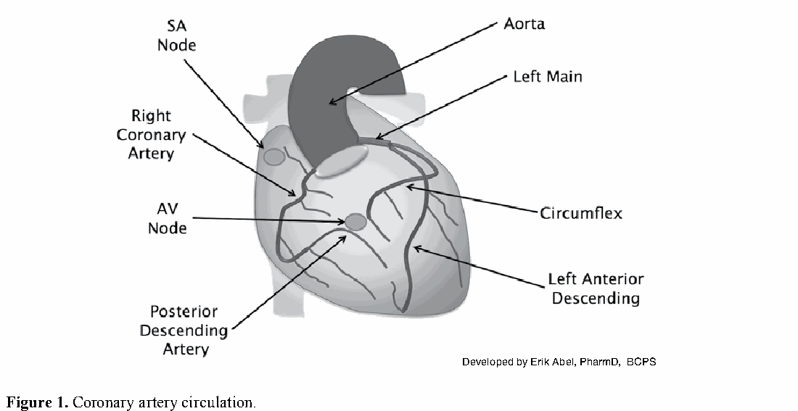
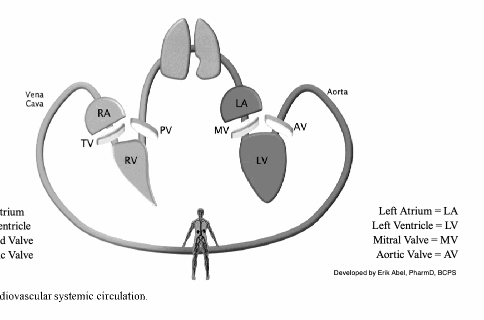
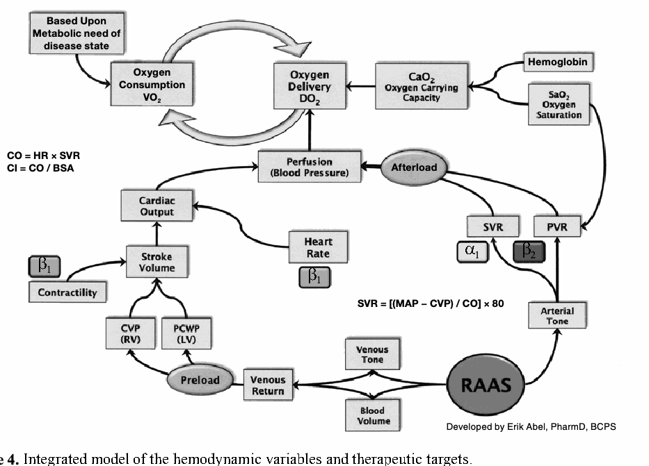
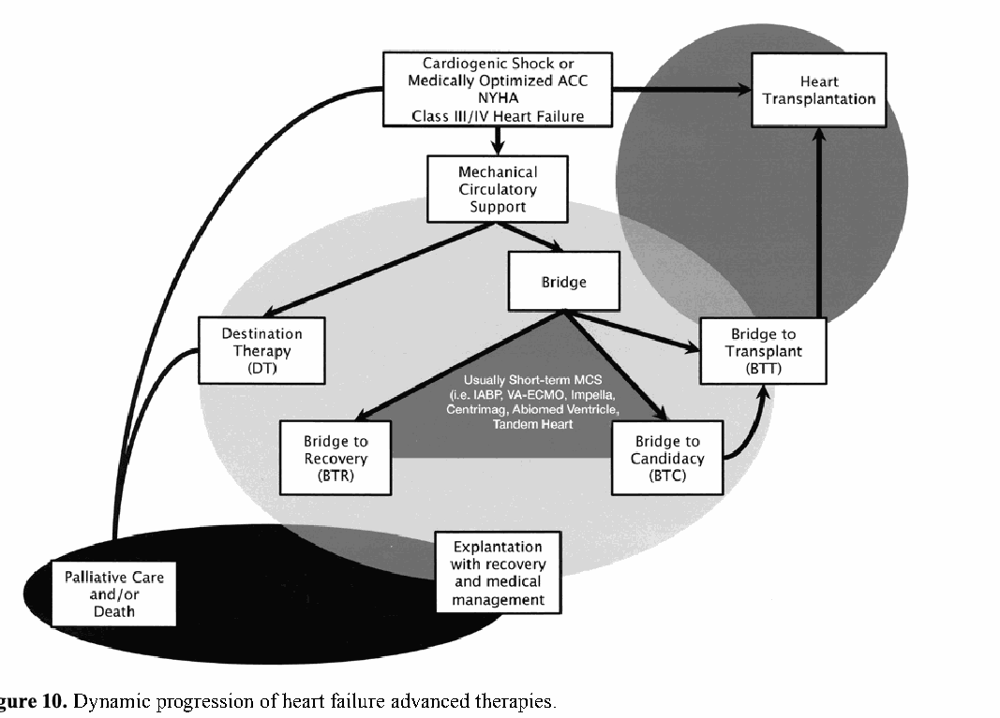

=== SOURCE PDF PAGE 1 ===
# Cardiovascular Critical Care I（心血管重症照護 I）
Stephanie Dwyer Kaluzna, Pharm.D., BCCP
University of Illinois Chicago College of Pharmacy
University of Illinois Hospital and Health Sciences System
Chicago, Illinois

=== SOURCE PDF PAGE 2 ===
（原檔空白頁）

=== SOURCE PDF PAGE 3 ===
# Cardiovascular Critical Care I（心血管重症照護 I）
Stephanie Dwyer Kaluzna, Pharm.D., BCCP
University of Illinois Chicago College of Pharmacy
University of Illinois Hospital and Health Sciences System
Chicago, Illinois
教材印刷頁碼：483。

=== SOURCE PDF PAGE 4 ===
## 學習目標
1. 依病人的 hemodynamic status 與客觀 cardiac findings，制定適當 pharmacotherapeutic regimen。
2. 為 cardiogenic shock 病人設計治療計畫。
3. 為有 cardiovascular diseases 的重症病人制定治療計畫，包括但不限於 CAD、arrhythmias、HF 及 valvular disease。
4. 辨識 mechanical circulatory support 與 heart transplantation 對 advanced HF、cardiogenic shock 病人的用途。
## 本章縮寫
|縮寫|英文全名／繁體中文說明|
|---|---|
|ABG|Arterial blood gas／動脈血液氣體|
|ACE|Angiotensin-converting enzyme|
|ACS|Acute coronary syndrome(s)／急性冠心症|
|AF|Atrial fibrillation／心房顫動|
|ARB|Angiotensin receptor blocker|
|AV|Atrioventricular|
|BNP|Brain natriuretic peptide|
|CABG|Coronary artery bypass grafting|
|CAD|Coronary artery disease／冠狀動脈疾病|
|CVP|Central venous pressure／中心靜脈壓|
|ECG|Electrocardiography／electrocardiogram|
|ECHO|Echocardiography／echocardiogram|
|ECMO|Extracorporeal membrane oxygenation|
|HF|Heart failure／心衰竭|
|HOCM|Hypertrophic obstructive cardiomyopathy|
|ICU|Intensive care unit／加護病房|
|LV|Left ventricle／ventricular|
|LVAD|Left ventricular assist device|
|LVEF|Left ventricular ejection fraction|
|MAP|Mean arterial pressure／平均動脈壓|
|MCS|Mechanical circulatory support|
|MI|Myocardial infarction／心肌梗塞|
|NSTEMI|Non–ST-segment elevation myocardial infarction|
|PCI|Percutaneous coronary intervention|
|PVR|Pulmonary vascular resistance|
|RV|Right ventricle／ventricular|
|SA|Sinoatrial|
|SCAI|The Society for Cardiovascular Angiography and Interventions|
|STEMI|ST-segment elevation myocardial infarction|
|SVR|Systemic vascular resistance|
|VAD|Ventricular assist device|
|VT|Ventricular tachycardia／心室頻脈|

## Self-Assessment Questions（自我評量題）
本章末提供答案及解析。
第 1–8 題與下列病例有關。
一名 58 歲男性（身高 71 inches，106 kg），在胸痛、呼吸困難持續惡化 24 小時後，由外院轉至 ICU。到院時 high-flow nasal cannula 給 oxygen 6 L，heparin infusion 16 units/kg/hour、dopamine infusion 15 mcg/kg/minute。紀錄顯示，在外院初始表現有 bradycardia（HR 50–58 beats/minute）、hypotension（78/49–86/55 mm Hg）。外院 12-lead ECG 的 II、III、aVF 有 ST elevation。依胸痛及 ECG，轉送前給 aspirin 324 mg（咀嚼後吞服）、clopidogrel 600 mg、morphine 4 mg IV 一次。紀錄亦指出，因 bradycardia、hypotension 暫停 β-blockers、nitroglycerin。
重要病史為 nonadherence、hypertension、diabetes、dyslipidemia、HFpEF；最近報告的 LVEF 是 1 年前 65%。病人表示目前在家未服任何藥物。
- 轉入 vital signs：BP 87/52 mm Hg、HR 110 beats/minute、RR 19 breaths/minute、temperature 99.7°F（37.6°C）。
- 理學評估：持續 distress、radiating chest pain 7/10、rales，無 cardiac murmurs，已有 right radial arterial line。
- 已有 urinary catheter，reservoir 有 20 mL 尿；病人稱最後排尿是昨天早上。外院記錄轉送前只有 30 mL。
- Chest radiography 顯示 diffuse patchy opacities，但報告指出無法排除 infiltrate。

=== SOURCE PDF PAGE 5 ===
- Serum chemistry panel：Na 132 mEq/L、K 4.2 mEq/L、chloride 102 mEq/L、carbon dioxide 22 mEq/L、BUN 34 mg/dL、SCr 1.9 mg/dL、glucose 163 mg/dL。
- CBC：WBC 11.3 × 10³ cells/mm³、hemoglobin 10.9 g/dL、hematocrit 31.1%、platelets 213,000/mm³。
- 其他 lab：troponin-T 3.9 ng/mL、AST 14 IU/L、ALT 46 IU/L、A1C 8.3%、BNP 1423 pg/mL。
1. 最可能的入院及轉院原因為何？
   A. Suspected pneumonia 導致 septic shock，後續 myocardial depression、demand ischemia。
   B. Acute on chronic decompensated systolic HF 導致 cardiogenic shock。
   C. Suspected inferior STEMI 導致 cardiogenic shock。
   D. Suspected lateral wall NSTEMI 導致 cardiogenic shock。
2. 哪條 coronary artery 最可能有 culprit lesion？
   A. Left main coronary artery。
   B. Left anterior descending artery。
   C. Left circumflex coronary artery。
   D. Right coronary artery。
3. Interventional cardiologist 評估 potential revascularization，要求 ICU 團隊放 central venous catheter。對 hemodynamic support，建議哪種改變／介入最佳？
   A. 增 dopamine，達 MAP > 65 mm Hg。
   B. 轉 norepinephrine，調整至 MAP > 65 mm Hg，同時漸停 dopamine。
   C. 開始 milrinone 0.375 mcg/kg/minute，繼續 dopamine 15 mcg/kg/minute。
   D. 因低尿量給 normal saline 1000 mL bolus。
4. 病人到 cardiac catheterization laboratory，廣播「code blue」，要求立即到處置區 emergency response。抵達時 chest compressions 剛暫停以 defibrillation，已給一次 epinephrine。團隊表示，嘗試顯影 RCA 時病人發生 VT。現在 telemetry 顯示 sinus tachycardia、ectopy，HR 113 beats/minute、BP 84/52 mm Hg。Cardiologist 因 bigeminy 擔心 VT 再發，要求 antiarrhythmic 建議。哪個最佳？
   A. Lidocaine 100 mg IV push，2–3 分鐘，再 infusion 1 mg/minute。
   B. Amiodarone 300 mg IV push，< 1 分鐘。
   C. Metoprolol 10 mg IV push，1–2 分鐘。
   D. Diltiazem 20 mg IV push，2 分鐘，再 continuous infusion 5 mg/hour，調至 HR < 110 beats/minute。
5. Femoral artery 進行 left heart catheterization 後回 ICU。除了急性失代償，接下來 12 小時最擔心哪項重大 procedural complication？
   A. Bleeding，尤其 retroperitoneal bleeding。
   B. Dissection／rupture。
   C. Stent thrombosis。
   D. Papillary muscle rupture。

=== SOURCE PDF PAGE 6 ===
6. 回 ICU 時有 PA catheter，dopamine 12 mcg/kg/minute、norepinephrine 0.08 mcg/kg/minute，HR 108 beats/minute、BP 82/51 mm Hg、CI 2.0、CVP 26 mm Hg、PA pressure 49/21 mm Hg。醫師擔心 shock 的 RV dysfunction，詢問升 BP 建議；希望漸停 dopamine，因 pulmonary hypertension，避免 PVR 再增加。哪種最佳？
   A. 維持目前 infusions，稍後再評估。
   B. Phenylephrine 1 mcg/kg/minute，MAP > 65 mm Hg 時漸停 dopamine。
   C. Vasopressin 0.04 unit/minute，MAP > 65 mm Hg 時漸停 dopamine。
   D. Normal saline 1 L bolus，MAP > 65 mm Hg 時漸停 dopamine。
7. 數小時後 AF，HR 126 beats/minute；依上一題選擇 regimen，BP 仍 86/56 mm Hg。最可能給哪種治 AF？
   A. Amiodarone 150 mg IV push，再 continuous infusion 1 mg/minute。
   B. Amiodarone 150 mg IV infusion，10 分鐘，再 continuous infusion 1 mg/minute。
   C. Metoprolol 5 mg IV push 一次，再 5 mg IV push 每 6 小時。
   D. Diltiazem 20 mg IV push，再 continuous infusion 5 mg/hour，調至 HR < 110 beats/minute。
8. 依 acute MI、preserved LVEF 的表現，哪個 medication-related quality metric 不需要 documented contraindications？
   A. Aspirin contraindication。
   B. Statin contraindication。
   C. β-blocker contraindication。
   D. ACE inhibitor／ARB contraindication。

=== SOURCE PDF PAGE 7 ===
## BPS Critical Care Pharmacy Examination 內容綱要
本章涵蓋以下部分：
1. Domain 1：Critical Care
   a. Task A：1, 2
   b. Task B：1
2. Domain 2：Therapeutics and Patient Management
   a. Task A：1, 2
   b. Task B：2
   c. Task C：2, 3
3. Domain 3：Professional Practice
   a. Task B：1

=== SOURCE PDF PAGE 8 ===
## I. CARDIOVASCULAR FUNDAMENTALS OVERVIEW
### A. Myocardium 的五項功能及特性
1. Chronotropy：以 intrinsic rate 產生 electrical impulse 的能力。
2. Dromotropy：促進 electrical impulse conduction 的速度與能力。
3. Inotropy：對特定 preload、afterload、HR 的收縮能力。
4. Bathmotropy：呈現 intrinsic excitatory threshold。
5. Lusitropy：myocardium relaxation，獨立於 contraction 的終止。
6. 其他相關 terms：
   a. Preload：end-diastole 時 ventricular cavity 的 blood volume，多數以 pressure 代表，對 resting myocardial sarcomere 施加 stretch。
   b. Afterload：ventricle 產生 cardiac output 必須克服的 pressure。Afterload（vascular resistance／impedance）越大，ventricle 射出血液所需 energy、force 越大。
### B. Coronary Artery Circulation
1. Myocardial perfusion 在 diastole 經 coronary arteries 發生。
2. 每人的 anatomy、perfusion 不同。
3. ECG abnormalities、hemodynamic assessment、症狀有助 CAD 定位。
4. Circulatory dominance：
   a. Right dominant：posterior descending artery、AV nodal artery 源自 RCA，占 85%。
   b. Left dominant：posterior descending artery 源自 circumflex，占 8%。
   c. Codominant：posterior descending artery 源自 circumflex 與 RCA branches，占 7%。
   d. 其他重要變異：SA node 供血血管也可不同；最常 RCA（約 70%）、circumflex（25%），或 RCA 加 circumflex（5%）。
#### 圖 1. Coronary Artery Circulation
Developed by Erik Abel, PharmD, BCPS。
圖中標籤：SA node（竇房結）、AV node（房室結）、right coronary artery（右冠狀動脈）、posterior descending artery（後降支）、aorta（主動脈）、left main（左主幹）、circumflex（迴旋支）、left anterior descending（左前降支）。

=== SOURCE PDF PAGE 9 ===
### C. Cardiac Anatomy 與 ECG 的關係（圖 2）
1. 單一 ECG lead tracing 是單一 cell action potentials 的總合表示，促進 myocardial conduction、contraction、relaxation。
2. 12-lead ECG 可提供 myocardial tissue conduction 的地理分布。特定 leads 的 conduction abnormalities，在某些臨床情境（即 ACS）可能顯示 perfusion defects。
#### 圖 2. Cardiac Anatomy 與 ECG 的關係
|Phase|Electrolyte movement|Conduction change|
|---|---|---|
|0|Na⁺ influx 入 cell|Depolarization|
|1|K⁺、Cl⁻ 出 cell|Repolarization|
|2|Ca²⁺ 入 cell、K⁺ 出 cell|Plateau|
|3|K⁺ 出 cell|Repolarization|
|4|Resting membrane potential|Resting membrane potential|
|ECG point|代表|
|---|---|
|P|SA node impulse generation／atrial depolarization|
|PR interval|自 SA node 經 AV node、bundle of His、bundle branches、Purkinje fibers 的 conduction duration|
|QRS|同時 atrial repolarization、ventricular depolarization|
|ST segment|Ventricular refractory period|
|T|Ventricular repolarization|
|QT interval|Ventricular repolarization duration|
|RR interval|兩次 ventricular depolarizations 的時間，代表 HR|
|U|額外 ventricular depolarizations，未列出或不常見；hypothermia、bradycardia、severe electrolyte depletion 可能更明顯|
|12-lead ECG|位置（血管）|
|---|---|
|I|Anterolateral（circumflex）|
|II|Inferior（RCA）|
|III|Inferior（RCA）|
|aVR|原圖未列位置|
|aVL|Anterolateral（circumflex）|
|aVF|Inferior（RCA）|
|V1|Anteroseptal（LAD）|
|V2|Anteroseptal（LAD）；posterior（RCA）|
|V3|Anteroapical（distal LAD）；posterior（RCA）|
|V4|Anteroapical（distal LAD）|
|V5|Anterolateral（circumflex）|
|V6|Anterolateral（circumflex）|
Adapted from ACLS instructor book。

## II. HEMODYNAMIC MANAGEMENT AND THE HEART
### A. Hemodynamic Assessment 依賴臨床醫師的能力：
1. 了解 cardiovascular circulation（圖 3），及單獨或結合其他變化與狀況時，影響 hemodynamic variables 的 pathophysiology。
2. 依 end-organ function 考量 trends，使用 oxygen delivery surrogates。
3. 了解 hemodynamic tools 的角色、使用限制，以及 devices／technology 解讀。
4. 辨識適當 therapeutic targets（圖 4），依 clinical response 應用 pharmacologic／pharmacodynamic principles（表 1）開始、調整或停止治療。

=== SOURCE PDF PAGE 10 ===
### B. Invasive Hemodynamic Monitoring 評估 Cardiac Output 及／或 Volume Status 的優缺點
1. Hemodynamic monitoring techniques 促進診斷。
2. HF 的 therapy guided by clinical assessment + PA catheter，相較僅 clinical assessment，overall mortality、hospitalizations 無差異。但 PA catheter-guided care 有更多預期 adverse events，如 infection、bleeding（JAMA 2005;294:1625-33）。
3. 然而，SCAI stages C–E cardiogenic shock，使用 PA catheter-derived hemodynamic data 與 improved mortality 相關（J Am Coll Cardiol HF 2020;8:903-13）。
4. 謹慎使用、熟練解讀，加 patient assessment，可指導 therapeutic interventions。
5. Invasive、minimally invasive devices 比較見 Shock Syndromes I 的表 2。
### C. Cardiovascular Critical Illness 的 Pharmacologic Support（表 1）
#### 圖 3. Cardiovascular Systemic Circulation
RA = right atrium；RV = right ventricle；TV = tricuspid valve；PV = pulmonic valve；LA = left atrium；LV = left ventricle；MV = mitral valve；AV = aortic valve。
Developed by Erik Abel, PharmD, BCPS。
循環順序：全身組織 → vena cava → RA → TV → RV → PV → 肺循環 → LA → MV → LV → AV → aorta → 全身組織。Vena cava 為腔靜脈，aorta 為主動脈；其餘縮寫如上。

=== SOURCE PDF PAGE 11 ===
#### 圖 4. Hemodynamic Variables 與 Therapeutic Targets 的整合模型
圖中整合關係：disease state 的 metabolic need 決定 VO₂，VO₂ 與 DO₂ 相互關聯。Hemoglobin、SaO₂ 決定 CaO₂／oxygen carrying capacity，再影響 DO₂。Perfusion／blood pressure 亦影響 DO₂。Cardiac output 與 afterload 共同影響 perfusion；HR（β₁）與 stroke volume 影響 CO；contractility（β₁）與 preload 影響 SV。Preload 連至 CVP（RV）、PCWP（LV）；venous return 影響 preload。RAAS 經 venous tone、blood volume 影響 venous return，經 arterial tone 影響 SVR（α₁、β₂）及 PVR，再影響 afterload。原圖亦將 SaO₂ 連至 PVR。
CO = HR × SVR〔原圖如此；請保留與原 PDF 對照〕。
CI = CO / BSA。
SVR = [(MAP − CVP) / CO] × 80。
Developed by Erik Abel, PharmD, BCPS。
BSA = body surface area；CI = cardiac index；CO = cardiac output；CVP = central venous pressure；HR = heart rate；MAP = mean arterial pressure；SVR = systemic vascular resistance。

#### 表 1. Cardiovascular Critical Illness 的 Pharmacologic Support
「+」保留原表相對作用強度；↑ 增加、↓ 降低、↔ 不變。
|Vasopressors／inotropes|Dopa|α₁|β₁|β₂|Other mechanism|HR|CVP|CO|SVR|PVR|
|---|---|---|---|---|---|---|---|---|---|---|
|Dopamineᵃ|+++++|+++|++++|++|—|↑|↔|↑|↔ 或 ↑|↔ 或 ↑|
|Epinephrine|—|++++|++++|+++|—|↑|↔ 或 ↑|↑|↑|↑|
|Norepinephrine|—|+++++|+++|++|—|↑ 或 ↔|↑|↑ 或 ↔|↑|↑|
|Phenylephrine|—|+++++|—|—|—|↔ 或 ↓|↑|↔ 或 ↓|↑|↑|
|Vasopressin|N/A|α₁-like effects|—|—|V₁、V₂ agonism|↔ 或 ↓|↑|↔ 或 ↓|↑|↔ 或 ↓|
|Angiotensin II|N/A|α₁-like effects|—|—|AT1 receptor agonism|↔ 或 ↓|↑|↔ 或 ↓|↑|↔ 或 ↑|
|Dobutamine|—|+|++++|++|—|↑|↔ 或 ↓|↑|↔ 或 ↓|↔ 或 ↓|
|Isoproterenol|—|—|+++++|+++++|—|↑|↔ 或 ↓|↑|↔ 或 ↓|↔ 或 ↓|
|Milrinoneᵇ|N/A|—|β₁-like effects|β₂-like effects|PDE₃ inhibition|↑|↓|↑|↓|↓|

=== SOURCE PDF PAGE 12 ===
#### 表 1. Cardiovascular Critical Illness 的 Pharmacologic Support（續）
|Vasodilators|Other mechanism|HR|CVP|CO|SVR|PVR|
|---|---|---|---|---|---|---|
|Nitroglycerin|cGMP|↔ 或 ↑|↓|↔ 或 ↑|↔ 或 ↓|↔ 或 ↓|
|Nitroprusside|cGMP|↔ 或 ↑|↓|↔ 或 ↑|↓|↓|
|Nitric oxide（inhaled）|cGMP|N/A|↔|↔ 或 ↑|↔|↓|
|Epoprostenol（inhaled）|cAMP|N/A|↔|↔ 或 ↑|↔|↓|
ᵃ High doses 與 α₁ activity 增加相關。
ᵇ 正常 half-life 2.5 小時，但經腎排除；因 hypotension，routine management 很少用 loading dose。
AMP = cyclic adenosine monophosphate；AT1 = angiotensin II type 1；cGMP = cyclic guanosine monophosphate；CVP = central venous pressure；HR = heart rate；N/A = not applicable；PDE3 = phosphodiesterase type 3；PVR = pulmonary vascular resistance；SVR = systemic vascular resistance。
Information from: Br J Pharmacol 2012;165:2015-33; J Am Coll Cardiol 2014;63:2069-78; Pathophysiol Heart Dis 2011:xiv; Circulation 2008;118:1047-56; Crit Care Med 2014:xix; J Pharm Pract 2011;24:44-60.

## III. CARDIOGENIC SHOCK
### A. 三項特徵
1. 持續 hypotension，僅 fluid administration 無反應；SBP < 90 mm Hg 至少 30 分鐘（Cardiol Clin 2013;4:567-80）。
2. Myocardial dysfunction，CI 減少（< 2.2 L/minute/m²）。
3. Volume overload、cardiac filling pressures 升高時，有 malperfusion signs／symptoms；例如 PCWP > 18 mm Hg。
### B. SCAI Cardiogenic Shock 分類（Catheter Cardiovasc Interv 2019;94:29-37）
1. Stage A：at risk；尚非 shock，但未來有風險。
2. Stage B：beginning；有 relative hypotension 或 tachycardia，無 hypoperfusion。
3. Stage C：classic；有 hypotension、hypoperfusion，需介入，包括 vasoactive therapies、MCS。
4. Stage D：deteriorating；stage C，雖試圖恢復最佳 hemodynamics 仍惡化。
5. Stage E：extremis；cardiac arrest，持續 CPR 或 ECMO。
### C. Signs 與 Symptoms
見 Heart Failure 章節。
### D. 流行病學
若無適當 diagnosis、management，已有 in-hospital mortality 高達 60% 的報告（Semin Respir Crit Care Med 2011;32:598-606）。

=== SOURCE PDF PAGE 13 ===
#### 圖 5. 各種 Acute HF Syndromes 的 ICU 病人隨時間變化的 Survival Rates
（Crit Care 2010;14:201）。
原圖四組：post-operative cardiac stunning（n=41）、congestive HF（n=56）、pulmonary oedema（n=27）、cardiogenic shock（n=62）。縱軸 survival（%）：0、20、40、60、80、100；橫軸 time（days）：30、60、90、120、150、180。
〔曲線數值請配合來源 PDF 第 13 頁；文字抽取無逐點數據。〕
### E. Etiology
1. 通常 acute MI 繼發 LV failure；其他潛在原因見 Box 1。
2. 可 multifactorial，包含一或多種病因；亦可與其他 shock syndromes 共存。

=== SOURCE PDF PAGE 14 ===
#### Box 1. Cardiogenic Shock 的潛在病因
（Critical Care Medicine 2014:xix; Cardiol Clin 2013;31:567-80, viii; Cardiol Clin 2013;31:519-31, vii-viii; Semin Respir Crit Care Med 2011;32:598-606）。
LV failure：
- Large MI。
- Small MI，原有 systolic HF。
- Reinfarction。
- Septic shock，伴 severe myocardial depression。
RV failure：
- RV infarction。
- End-stage pulmonary hypertension。
Acute mechanical dysfunction：
- Papillary muscle／chordal rupture，後續 severe mitral regurgitation。
- Free-wall rupture。
- Ventricular septal rupture。
- Cardiac tamponade。
Cardiomyopathy：
- End-stage HF。
- Myocarditis。
- Peripartum cardiomyopathy。
- LV outflow tract obstruction。
- Stress-induced cardiomyopathy（Takotsubo）。
Valvular disease：
- Acute aortic regurgitation。
- Ischemic mitral regurgitation。
- Aortic／mitral stenosis，合併 tachyarrhythmia 或其他失代償原因。
- Infectious endocarditis。
- Prosthetic valve dysfunction／thrombosis。
Arrhythmias：
- Atrial tachyarrhythmias。
- Ventricular tachyarrhythmias。
- Bradycardia。
其他：
- Prolonged cardiopulmonary bypass 及／或 coronary air embolus。
- Cardiac trauma（blunt／penetrating）。
- Heart transplant rejection。
- Pulmonary embolism。
- Medical nonadherence。
HF = heart failure；LV = left ventricular；MI = myocardial infarction；RV = right ventricular。
### F. Resuscitation／Treatment
1. 治療主要取決於 Box 1 的 underlying chronic／acute cardiovascular diseases，並考慮 shock 前 clinical changes 的慢性程度。
2. 管理主要在 IV–VII 的 Major Contributing Etiologies 說明。
3. Hemodynamic management、pharmacotherapeutic considerations：
   a. CS 可能有不同 underlying／contributing etiologies，需仔細解讀 clinical values；可依圖 6 algorithm 制定策略。

=== SOURCE PDF PAGE 15 ===
   b. DOREMI：Milrinone Compared with Dobutamine in CS（N Engl J Med 2021;385:516-25）。
      i. 首個在 index hospitalization 前瞻性研究 milrinone、dobutamine 管理 CS 的 trial（n=192）。
         (a) Median EF 25%，約三分之二 ischemic cardiomyopathy；大多數（90%）為 SCAI C、D。
         (b) 初始劑量依 1–5 standard dosing scale：dobutamine 對應 2.5、5、7.5、10、> 10 mcg/kg/minute；milrinone 對應 0.125、0.25、0.5、> 0.5 mcg/kg/minute〔原文 milrinone 僅列四值〕。以 blinded fashion 調整。
      ii. Composite primary outcome（all-cause in-hospital mortality、resuscitated cardiac arrest、cardiac transplantation 或 MCS、nonfatal MI、TIA／stroke、開始 renal replacement therapy）無差異。重要的是，研究凸顯 CS mortality 仍高，約 40%。
      iii. 兩藥引起需 intervention arrhythmias 的比例均高；sustained hypotension、vasopressor requirements 無差異。
   c. SOAP II（N Engl J Med 2010;362:779-89）。
      i. International multicenter trial（n=1679），比較 norepinephrine、dopamine 管理 shock 的 28-day mortality。
         (a) 納入 malperfusion，充分 fluid challenge 後仍 MAP < 70 或 SBP < 100 mm Hg；challenge 至少 1000 mL crystalloid 或 500 mL colloid，除非 CVP > 12 或 PA occlusion pressure > 14 mm Hg。
         (b) Norepinephrine 可調至 0.19 mcg/kg/minute，dopamine 至 20 mcg/kg/minute；之後可 open-label norepinephrine，研究期不超過 1.1 mcg/kg/minute。
         (c) Epinephrine、vasopressin 可 rescue，兩組使用相似。
         (d) Norepinephrine 組 dobutamine 使用更多，19.4% vs. 14.8%。
      ii. Subgroup analysis 的 CS 病人，dopamine mortality 顯著高於 norepinephrine（可合併／不合併 dobutamine）。
      iii. 所有 shock subtypes 的 dopamine adverse events 較多，主要 arrhythmias（24.1% vs. 12.1%，p < 0.001）；tachyarrhythmias 在隨機後前 36 小時最多。
   d. OptimaCC：Epinephrine、Norepinephrine 的 efficacy／tolerability（J Am Coll Cardiol 2018;72:173-82）。
      i. Prospective、double-blind、multicenter randomized study（n=57），比較 post-MI CS 的 CI evolution、refractory CS。
      ii. CI evolution 無差異，但 epinephrine refractory CS 顯著較高，37% vs. 7%。
      iii. Epinephrine 的 tachycardia、lactic acidosis 亦顯著增加。

=== SOURCE PDF PAGE 16 ===
#### 圖 6. 依 Hemodynamic Indices 的 Shock Management 與 Treatment Considerations
Preload：
- CVP／PCWP 下降：crystalloid／colloid 500 mL、blood products、passive leg raising。
- CVP／PCWP 升高：loop ± thiazide diuretic、其他 fluid removal。
Afterload：
- PAP 升高，可能 HR 升高：milrinone、nitroglycerin、nitroprusside、inhaled vasodilators。
- BP 下降／HR 升高：phenylephrine〔原圖拼寫 Phenylepherine〕、vasopressin。
- BP 下降：norepinephrine、dopamine。
- BP 升高，可能 HR 升高：nitroprusside、nitroglycerin、其他 IV antihypertensive。
Contractility：
- CO／CI 下降、normotensive／hypertensive：milrinone、dobutamine。
- BP 下降／unresponsive：epinephrine。
- HR 下降、有症狀、可能 BP 下降：epinephrine、dobutamine、isoproterenol、dopamine。
Adapted from: Blais, DM. PSAP-IV: Critical and urgent care. 2010.

## Patient Case（病人病例）
第 1–8 題與以下病例有關。
J.M.，68 歲男性，CAD 病史包括 6 個月前 STEMI、放兩個 drug-eluting stents；另有 type 2 diabetes、hypertension、dyslipidemia、GERD、OSA、frequent epistaxis、ischemic cardiomyopathy（LVEF 30%–35%）、moderate-to-severe mitral regurgitation。因 severe shortness of breath、altered mental status 入 cardiac ICU，目前 CPAP。過去 2 週增重 13 kg（現 121 kg），diuretic dose 已增加仍尿量下降。Home medications：aspirin 81 mg daily、ticagrelor 90 mg 每 12 小時、pantoprazole 40 mg daily、atorvastatin 40 mg daily、insulin glargine 10 units 每晚、metformin 500 mg 每 12 小時、furosemide 40 mg BID、potassium chloride 20 mEq BID。妻子稱原服 clopidogrel，1 個月前因費用，primary care physician 給 ticagrelor samples。理學檢查整個 lung fields 都有 rales；無 fever、anxious、alert。
1. 依 comorbidities，有些 drugs／classes 已證實 mortality benefits。哪些可加入或調整 home profile，減緩 progression、改善 mortality？
   A. Amlodipine、clopidogrel、sitagliptin。
   B. Spironolactone、lisinopril、carvedilol。
   C. Pravastatin、amlodipine、aspirin。
   D. Prasugrel、sildenafil、atenolol。
2. 哪組 diagnostic tests 最能指導目前管理建議？假設 Chem 7、pulse oximetry、capillary glucose 已做。
   A. Urine culture、respiratory culture、lactate、procalcitonin。
   B. Chest radiography、ABG、liver function tests、serial troponins。
   C. Chest radiography、ECHO、lactate、BNP。
   D. Chest radiography、arterial line、ABG、lactate。

=== SOURCE PDF PAGE 17 ===
## Patient Case（續）
3. 已安排前述全部檢查，結果如下。J.M. BP 90/56 mm Hg（MAP 67）、HR 56 beats/minute。12-lead ECG 為 normal sinus rhythm，無 acute ST-T changes。
- Chest radiography：diffuse patchy opacities，不能排除 infiltrate；所有 lines 位置正確。
- Chemistry：Na 126、K 4.8、chloride 102、carbon dioxide 21 mEq/L；BUN 32 mg/dL、SCr 1.6 mg/dL、glucose 134 mg/dL。
- CBC：WBC 9.8 × 10³ cells/mm³、Hgb 11.1 g/dL、Hct 32.6%、platelets 173,000/mm³。
- Troponin 0.9 ng/mL、AST 114 IU/L、ALT 102 IU/L、BNP 1936 pg/mL。
- Invasive variables：CVP 28 mm Hg、PA pressures 46/22 mm Hg、CI 1.8 L/minute/m²、Scvo₂ 53%；PA occlusion pressure 尚無。
- ABG：pH 7.36、Po₂ 93.7、Pco₂ 43.2、bicarbonate 23.9、O₂ saturation 89%、lactate 6.9。
- ECHO 待結果。
Extremities 冰冷，capillary refill 差。已下 furosemide 80 mg IV 一次，並希望開始 vasopressor／inotrope。此刻最佳建議？
   A. Norepinephrine 0.08 mcg/kg/minute。
   B. Epinephrine 0.08 mcg/kg/minute。
   C. Milrinone 0.75 mcg/kg/minute。
   D. Dobutamine 5 mcg/kg/minute。

## IV. ACUTE CORONARY SYNDROMES
### A. Pathophysiology
1. 部分 myocardium 的 oxygenated blood supply 長時間停止，最常由 coronary atherosclerotic stenosis 處 acute thrombus 引起，造成 local／regional myocardial ischemia、necrosis。
2. 其他 disease states 增加 myocardial oxygen demand，同時無法供應，可能需考慮「demand ischemia（type II NSTEMI）」而非 ACS。
### B. 表現與診斷
（Circulation 2014;130:e344-426; Circulation 2013;127:e362-425）。雖有其他 cardiac enzyme assays，通常用 cardiac troponins 作 myocardial necrosis 敏感指標；troponin 陰性對 MI 的 NPV > 95%。Troponin 經腎排除，end-stage renal disease 常無其他 myocardial ischemia 證據，仍 cardiac troponin 升高。因此需評估其他 ACS signs／symptoms，以及 troponin increase rate。

=== SOURCE PDF PAGE 18 ===
#### 圖 7. ACS 表現與診斷
依 signs／symptoms 臨床懷疑 ACS：
- 非 traumatic chest pain／discomfort，放射至 neck、jaws、shoulders；或 anginal equivalents：持續 shortness of breath、nausea／vomiting、indigestion、新 weakness／malaise。
- CAD、MI、CABG、PCI 病史者，更應懷疑。
- 女性、elderly、diabetes 常 atypical symptoms，例如 epigastric pain、back pain。
12-lead ECG positive：≥ 2 個 contiguous leads ST elevation，或 new LBBB；cardiac enzymes positive → STEMI。
12-lead ECG negative：minimal changes 到 ischemic changes，包括 T-wave inversion、ST depression；cardiac enzymes positive → NSTEMI；negative → unstable angina。
NSTEMI、STEMI 歸為 acute MI。
#### Box 2. Troponin Elevation 的原因（Heart 2006;92:987-93）
Acute decompensated HF、acute MI、acute pulmonary embolism、aortic stenosis、cardiac amyloidosis、cardiotoxic chemotherapy、chest compressions、chest wall trauma／compressions、chronic HF、direct-current cardioversion／defibrillation、early post-cardiac surgery、heart transplantation、myocarditis、pericarditis、post-PCI、rhabdomyolysis、sepsis、severe strenuous exercise、tachyarrhythmia、type A aortic dissection。
PCI = percutaneous coronary intervention。

=== SOURCE PDF PAGE 19 ===
### C. MI 的 Acute Management
#### 表 2. Acute Management（Circulation 2014;130:e344-426; Circulation 2013;127:e362-425）
|項目|STEMI|NSTEMI／unstable angina|
|---|---|---|
|Goals of care|盡快 reperfusion。First medical contact 90 min 內可做，首選 primary PCI；若無法立即且預期到院至 PCI > 120 min，無 contraindications 者到院 30 min 內 fibrinolytic。依 CAD severity、anatomic complexity、其他 complications，可有 surgical revascularization 適應症|防 vessel total occlusion。依 risk stratification、symptom resolution、ongoing myocardial damage／ischemia indicators，決定 revascularization（PCI／surgery）或 medical management|
CAD = coronary artery disease。
#### 表 3. 所有 ACS 初始表現／起始時的主要穩定措施
（Circulation 2014;130:e344-426; Circulation 2013;127:e362-425）。
Morphine 或其他 narcotic analgesic：
- 提供 analgesia，降低 pain-induced sympathetic／adrenergic tone。
- 常用 morphine，因可 vasodilation、減少 myocardial／microvascular damage，並降低部分 preload，因而減少 oxygen demand。
- Morphine 也是 ticagrelor／prasugrel high residual platelet reactivity 的 independent predictor，可能 delayed gastric emptying 損害 absorption（Am Heart J 2014;6:909-14）。
- 現為 class IIb-B，可能不比其他 narcotics 更受偏好；至少兩大型 trials 發現 administration 與 death risk 相關（N Engl J Med 2014;371:1016-27; Am Heart J 2005;149:1043-9; J Am Coll Cardio. 2014;64:e139-228）。
Oxygen：
- 可減輕 tissue hypoxia 的 anginal pain。
- Normal Sao₂ 無 supplemental oxygen benefit，且可能 harm（N Engl J Med 2017;13:1240-9; Circulation 2015;24:2143-50）。
- Sao₂ < 90%、respiratory distress、其他 high-risk hypoxemia features 可考慮。
Nitrates：
- 促進 coronary vasodilation；venous capacitance 增加，也可幫助 severe cardiogenic pulmonary edema。
- NTG 0.4 mg sublingual，每 5 分鐘，共三次，再評估 IV NTG。
- Ischemia、HF、hypertension 起始前 48 hr 有 IV NTG 適應症，但不可排擠有適應症的 β-blockers／ACE inhibitors。
- 下列不可給：SBP < 90，或比 baseline 低 > 30 mm Hg；severe bradycardia（含 heart block），HR ≤ 50；無 symptomatic HF 的 tachycardia，HR ≥ 100；inferior ECG ischemic changes 顯示 RV infarction；過去 24–48 hr 服 oral PDE inhibitor 或 riociguat。

=== SOURCE PDF PAGE 20 ===
#### 表 3. 初始穩定措施（續）
Aspirin：
- 抑制 platelet activation。
- 立即咀嚼吞服 4 顆 81 mg（共 324 mg），或一顆 325 mg non-enteric-coated。
β-blockade：
- 降低 early post-MI ventricular arrhythmias、sudden cardiac death。
- 降 HR、oxygen demand，增加 diastolic ventricular filling time，改善 coronary oxygen flow。
- ACS 前 24 hr 開始，除非有 HF signs、其他 active shock，或 cardiogenic shock 高風險：SBP < 120、HR > 110 或 < 60、age > 70、症狀起始更久。
- Relative contraindications：PR > 0.24 s、second-／third-degree heart block、active asthma／reactive airway disease。
- 注意：IV β-blockers 對 shock risk factors 者可能特別有害。
助記 MONA ± BB：morphine、oxygen、nitrates（無 contraindication）、aspirin、β-blocker（無 contraindication）。
其他 precautions：
- ACS 前 24 hr ACE inhibitors／ARBs 謹慎，因 hypotension、可能 contrast-induced nephrotoxicity。
- 除 aspirin 外 NSAIDs 應避免／停用；除 GI bleeding、nephrotoxicity 外，也有 reinfarction、hypertension、HF exacerbation、myocardial rupture，以及 overall mortality 增加。
ACS = acute coronary syndrome(s)；GI = gastrointestinal；HF = heart failure；IV = intravenous；LMNOP = lasix-morphine-nitro-oxygen-position／positive pressure ventilation；NSAID = nonsteroidal anti-inflammatory drug；RV = right ventricular；Sao₂ = arterial oxygen saturation。
### D. Revascularization
1. Nonsurgical：Interventional cardiology procedure 細節太廣，無法在此詳述；left heart catheterization、PCI 中下列因素可影響 post-procedural management。
   a. Access site
      i. Radial artery，少數 brachial（Catheter Cardiovasc Interv 2011;78:840-6）。
         (a) 易取得。
         (b) Procedure vasospasm risk 增加。
         (c) Post-procedure hemostasis 易壓迫。
         (d) 不妨礙 post-procedure mobility。
      ii. Femoral artery
         (a) 易取得。
         (b) Hemostasis 較難壓迫，bleeding complications 增加。

=== SOURCE PDF PAGE 21 ===
         (c) Post-procedure 至少 12–24 小時限制 mobility，因 sheath removal 後 bleeding risk。
   b. 常見 interventions：
      i. Stent placement
         (a) 注意數量、types、locations。
         (b) Bare metal stent
            (1) 終生 aspirin，P₂Y₁₂ antagonist 至少 1 個月（prefer 12），讓 endothelialization 有足夠時間。
            (2) 依數量、locations，可考慮更久。
            (3) 因 neointimal proliferation，in-stent stenosis 隨時間 risk 較高。
         (c) Drug-eluting stent
            (1) 終生 aspirin，P₂Y₁₂ antagonist 至少 6 個月（prefer 12）。依數量、locations、bleeding risk，可更長／短。部分可用 modified DAPT：1–3 個月後停 aspirin，剩下 9–11 個月 P₂Y₁₂ monotherapy（Circulation 2022;145:e18-114）；duration 需 individualized。
            (2) Everolimus、zotarolimus、biolimus 等 DES benefit 是減少 bare metal 更常見的 restenosis。但 endothelialization 亦受抑，stent thrombosis risk 更久，因此須較長 DAPT。
      ii. Thrombectomy：thrombus aspiration 後，通常 lesion 處 stent。
      iii. PTCA，亦稱 POBA：balloon expansion，使 lesion occlusion 至少暫時移開。
2. Surgical：CABG 細節，包括 conduit、cardiopulmonary bypass／off-pump，太廣而不詳述。STS／ACC／AHA 指引中，acute MI 下列 emergency CABG（J Am Coll Cardiol 2011;58:e123-210）：
   a. Primary PCI 失敗／不能做。
   b. Anatomy 更適合 CABG。
   c. 休息時顯著 myocardium persistent ischemia，及／或 nonsurgical refractory hemodynamic instability。
   d. 需修補 postinfarction mechanical complication，如 ventricular septal rupture、papillary infarction／rupture 致 mitral insufficiency、free-wall rupture。
   e. 適合 CABG 的 CS，不論 MI 至 shock、MI 至 CABG 的間隔。
   f. Life-threatening ischemic ventricular arrhythmias，加 left-main stenosis ≥ 50% 及／或 three-vessel CAD。

=== SOURCE PDF PAGE 22 ===
   g. Multivessel CAD，在 STEMI 前 48 小時 recurrent angina／MI，CABG 可替代更延遲策略。
   h. > 75 歲，ST elevation／LBBB 且適合者，early PCI／CABG 合理，不論 MI 至 shock 間隔。
3. Medical management：無 revascularization。
   a. 部分可選較不 invasive strategy；以 patient-centered approach，根據 ongoing／recurrent ischemia、feasibility，包括 myocardial viability、frailty、comorbidities。
   b. E 節 ongoing care 仍是最佳化 aggressive medical management 焦點。
### E. MI 的 Antithrombotics
1. NSTEMI／ACS、STEMI、PCI 等族群的 roles、combinations 持續修訂；最新 guidelines、landmark trials 見 www.acc.org/guidelines。
2. Oral antiplatelet therapy
   a. Platelets 可經多種 mechanism activation，只有部分可用藥抑制。
   b. 可 platelet function testing／genotyping 評估，但現在臨床都非 routine。PCI 的 high on-treatment reactivity，以 testing 調整 high-dose vs. standard clopidogrel，至今 outcomes 陰性（JAMA 2011;305:1097-1105）。大型 PCI cohorts 的 prospective CYP2C19 genotype-guided therapy，MACE、bleeding 均較低（JACC Cardiovasc Interv 2018;2:181-91; J Am Coll Cardiol 2018;71:1869-77; N Engl J Med 2019;381:1621-31）。
   c. Acute hepatic／kidney injury 等重症情境 response 未充分記錄。無法 enteral 時可 parenteral（表 5），包括 GP IIb/IIIa inhibitors、cangrelor，主要研究於 PCI，但有 bridging data。

=== SOURCE PDF PAGE 23 ===
#### 表 4. Oral Antiplatelet Therapy
（Circulation 2013;127:e362-425; Circulation 2014;130:e344-426; J Am Coll Cardiol 2011;58:e123-210; J Am Coll Cardiol 2011;58:e44-122; Br J Clin Pharmacol 2011;72:647-57）。
|項目|Aspirin|Clopidogrel|Prasugrel|Ticagrelor|
|---|---|---|---|---|
|Mechanism|抑制 thromboxane A₂-mediated activation|抑制 P₂Y₁₂ 的 ADP-mediated activation|抑制 P₂Y₁₂ 的 ADP-mediated activation|抑制 P₂Y₁₂ 的 ADP-mediated activation|
|Loading dose|162–325 mg|300–600 mg|60 mg|180 mg|
|Maintenance|81 mg daily|75 mg daily|5–10 mg dailyᵃ|90 mg BID|
|Route|Oral|Oral|Oral|Oral|
|Prodrug|No|Yes|Yes|No|
|Reversible binding|No|No|No|Yes|
|Onset|30 min|2–6 hr|30 min|30 min|
|Platelet inhibition %|約 10–20|30–40|60–70|60–70|
|CABG 前 holdᵇ|不停|5 days|7 days|3 days|
|其他 effects／pearls|原表無列|CYP2C19 pharmacogenomic response variability 已充分記錄|任何 stroke／TIA history 因 bleeding contraindicated；≥ 75 歲、< 60 kg 有 warnings|Adenosine-induced dyspnea、bradyarrhythmias；older adults、moderate／severe hepatic impairment 可能 bleeding 增；avoid maintenance aspirin > 100 mg，因缺 efficacy|
ᵃ Lean body weight < 60 kg，prasugrel maintenance 5 mg daily。
ᵇ 其他 invasive procedures 前 hold，需考慮 indication、thrombosis risk（stent type、locations、number）、procedure／surgery bleeding risk（JAMA 2013;310:1451-2; Catheter Cardiovasc Interv 2013;82:1113-4; JAMA 2013;310:189-98; N Engl J Med 2013;368:2113-24; J Am Coll Cardiol 2011;58:e44-122; Reg Anesth Pain Med 2010;35:64-101; J Am Coll Cardiol 2007;49:734-9）。
ADP = adenosine diphosphate；BID = twice daily；TIA = transient ischemic attack。
3. Parenteral antithrombotics
   a. 最集中用於 procedures，但可於 post-procedure 繼續一段期間。
   b. 表 5 選擇可能依 presentation、pre-procedural antiplatelet timing／dose、procedural clot burden、estimated bleeding risk。

=== SOURCE PDF PAGE 24 ===
#### 表 5. Parenteral Antithrombotics
（Circulation 2014;130:e344-426; Circulation 2013;127:e362-425; Circulation 2015;131:1123-49; J Am Coll Cardiol 2011;58:e123-210; J Am Coll Cardiol 2011;58:e44-122; Br J Clin Pharmacol 2011;72:647-57）。
|項目|Heparin（UFH）ᵃ|Bivalirudin|Eptifibatide|Tirofiban|Cangrelorᵇ|
|---|---|---|---|---|---|
|Mechanism|與 antithrombin III 結合，indirect thrombin inhibition|Direct thrombin inhibitor|結合 GP IIb/IIIa，抑制 platelet aggregation final common pathway|結合 GP IIb/IIIa，抑制 platelet aggregation final common pathway|抑制 P₂Y₁₂ 的 ADP-mediated activation|
|Bolus|50–100 units/kg，依 target ACT|0.75 mg/kg|180 mcg/kg 兩次，相隔 10 min|25 mcg/kg|30 mcg/kg|
|Continuous infusion|PCI 通常不給|1.75 mg/kg/hr|2 mcg/kg/min|0.15 mcg/kg/min|4 mcg/kg/min|
|Platelet inhibition|間接抑制 thrombin-mediated activation|間接抑制 thrombin-mediated activation|停藥 6–8 hr platelet function 恢復|停藥 6–8 hr platelet function 恢復|給藥數分鐘 onset；停藥 1 hr 恢復|
|Elimination|Hepatic、reticuloendothelial system|80% plasma proteolysis、20% renal|50% renal|65% renal|Plasma dephosphorylation|
|Dialysis removal|No|Partial|Yes|Yes|N/A|
|其他 effects／pearls|Procedure ACT 約 200–300 s，依 GP IIb/IIIa inhibitor、device|需 renal adjustment；suspected／confirmed HIT 有用；high bleeding risk 可能首選，尤其相較 UFH + GP IIb/IIIa，及 transfemoral PCI|需 renal adjustment；acute profound thrombocytopenia|需 renal adjustment；acute profound thrombocytopenia|停 infusion 後立即 oral prasugrel／clopidogrel 維持 inhibition。Ticagrelor 盡快給，可與 infusion 重疊，維持停 cangrelor 後 inhibition|
ᵃ Enoxaparin 可替代 UFH。
ᵇ FDA 核准 adjunct to PCI，減少 periprocedural MI、repeat coronary revascularization、stent thrombosis；用於尚未 P₂Y₁₂ inhibitor 且未 GP IIb/IIIa inhibitor 的病人。
ACT = activated clotting time；GP = glycoprotein；HIT = heparin-induced thrombocytopenia；N/A = not applicable；UFH = unfractionated heparin。

=== SOURCE PDF PAGE 25 ===
### F. Post-Intervention Complications
1. Bleeding，尤其 retroperitoneal。
   a. PCI 用多種 antithrombotics 抑制 platelets、clotting cascade，可 coagulopathies。
   b. Access site 也是主要 contributor；transradial 相較 transfemoral 已證實 bleeding avoidance strategy。
2. Free wall、coronary artery、aorta dissection／rupture：可自發，也可 catheter vessel trauma 引起。
3. Stent thrombosis
   a. Antiplatelet early cessation（aspirin、P₂Y₁₂、或兩者），不論 DES／bare metal，最高 25% stents 可 thrombosis。
   b. 近 1/7 可能 PCI 後 30 天內停 P₂Y₁₂，mortality risk 增：adjusted HR 9.0，95% CI 1.3–60.6（JAMA 2013;310:189-98）。
   c. 相關 mortality 高達 45%。
   d. 雖重症 bleeding risk，需仔細與 stent thrombosis risk 相互考量。
4. Papillary muscle rupture、mitral regurgitation（mechanical complications）。
5. Arrhythmias，尤其 reperfusion 後。
6. Contrast-induced nephropathy。
### G. Ongoing Care
NSTEMI／STEMI quality measures，不論 revascularization／medical management。
1. 出院前開始，或 medical record 記錄 contraindications：
   a. Aspirin。
   b. High-intensity statin。
   c. P₂Y₁₂ inhibitor。
   d. β-blocker。
   e. 若 LVEF ≤ 40%：
      i. ACE inhibitor、ARB、或 ARNI。
      ii. Aldosterone antagonist，若亦 HF 及／或 diabetes。
      iii. SGLT2 inhibitor，若其他 compelling indications，如 diabetes、CKD。
2. Interventions／referrals：
   a. LV function assessment，以 imaging 或 catheterization。
   b. Cardiac rehabilitation。
   c. Smoking cessation counseling。
   d. Lipid profile（含 LDL cholesterol）最好入院 24 小時內；first medical contact 前 6 個月至出院間任何一次均符合此 quality measure。
3. 更多 cardiology quality measures、registries 見 www.ncdr.com。

=== SOURCE PDF PAGE 26 ===
## Patient Case（續）
4. ECG 無 acute ST changes，但 resident 因呼吸困難、mild troponin elevation，仍考慮 ACS。關於其他可能 diagnosis，哪項最準確？
   A. 否，最可能 NSTEMI。
   B. 是，可能未診斷 COPD。
   C. 是，可能 early sepsis。
   D. 是，可能 decompensated HF。
5. Telemetry 有 intermittent bradycardia，已 consult cardiac electrophysiology。是否可處理其他 underlying correctable／contributing causes，哪項最準確？
   A. 可停 ticagrelor，換回 clopidogrel。
   B. Ticagrelor 完全停用。
   C. 無需介入，可能 HF progression。
   D. 應治 hyperkalemia。

## V. ARRHYTHMIAS AND ANTIARRHYTHMICS
### A. Pathophysiology
通常由 automaticity 及／或 reentrant conduction abnormalities。
### B. Bradyarrhythmias（非 Sinus）與 Heart Block Types
（Critical Care Medicine 2014:xix; Pathophysiology of Heart Disease 2011:xiv; BMJ 2002;324:662-5; BMJ 2002;324:415-8）。
1. Heart block etiologies（Box 3）。
#### Box 3. Bradyarrhythmias 原因
CAD、degenerative conduction disease、drug-induced、electrolyte disturbances（尤其 hyperkalemia）、endocarditis、myocarditis、surgery（尤其 cardiac）、tumors、vagus nerve-mediated heart block。
CAD = coronary artery disease。
2. Heart block ECG 的 QRS 評估，可協助 differential diagnosis，定位 conduction problems（表 6）。
   a. Narrow QRS 常 AV nodal dysfunction。
   b. Wide QRS 可 AV node 或 His-Purkinje dysfunction。

=== SOURCE PDF PAGE 27 ===
#### 表 6. Bradyarrhythmias 與 Heart Block Types
（Critical Care Medicine 2014:xix; Pathophysiology of Heart Disease 2011:xiv; BMJ 2002;324:662-5; BMJ 2002;324:415-8）。
|Type|Description|
|---|---|
|First degree|SA 至 AV conduction 延遲，PR > 0.2 s；相對 benign，但評估並減少 underlying contributors，如 β-blockers、其他 AV nodal blockers|
|Second-degree Mobitz 1（Wenckebach）|PP 一致、PR 漸增，顯示 SA→AV conduction 受損；最後 atrial impulse 無 AV conduction，缺 QRS。Older adults 最需擔心 progressive conduction disease；年輕可能較 benign。助記：「Longer, longer, longer, drop … must be Wenckebach」|
|Second-degree Mobitz 2|PP、PR duration 一致，自發缺 QRS，因 atrial impulse 未經 AV node；通常更嚴重 disease，與 syncope、HF、mortality 增加相關|
|Third degree（complete block）|PP、RR 一致，PR 不定／隨機；atrial、ventricular conduction 獨立且不協調，AV dissociation。原 ECG 箭頭標 P waves，顯示 PP 規則、PR 不定|
|Junctional rhythm|Sinus dysfunction，使 AV node 接任 pacemaker，retrograde conduction 經 atria|
〔各 ECG examples 圖形請配合原 PDF 第 27 頁。〕

=== SOURCE PDF PAGE 28 ===
#### 圖 8. ACLS Bradycardia Algorithm
依臨床情境評估是否適當；bradyarrhythmia 通常 HR < 50 bpm。
辨識與治療 underlying cause：維持 airway、必要時 assist breathing；short of breath 給 oxygen；依適應症 oxygen；cardiac monitor 辨 rhythm、監測 BP、oximetry；IV access；有 12-lead ECG 則做，但不延誤。
Persistent bradyarrhythmia 是否造成 hypotension、acute altered mental status、shock signs、ischemic chest discomfort、acute HF？否：monitor／observe。是：atropine IV first 1 mg，每 3–5 min 重複，max 3 mg。
無效：transcutaneous pacing，或 dopamine 5–20 mcg/kg/min IV infusion，或 epinephrine 2–10 mcg/min IV infusion。
考慮 expert consultation、transvenous pacing。
Adapted from 2020 AHA CPR／Emergency Cardiovascular Care guidelines（Circulation 2021;142(14_suppl_2):S366-468）。

=== SOURCE PDF PAGE 29 ===
3. Bradyarrhythmia management 三項主要策略，亦見圖 8；有症狀先穩定。
   a. Atropine 暫時減 vagal tone；1 mg 每 3–5 min，max 3 mg。
   b. Pacing：temporary transvenous、transcutaneous、pacing PA catheter；檢查 permanent pacemaker malfunction／optimization。
   c. Chronotropic β-agonist infusion。
      i. Dopamine。
      ii. Epinephrine。
      iii. Isoproterenol。
      iv. Dobutamine，若 BP normal／elevated。
   d. 辨識、治 underlying causes／toxidromes。
### C. Tachyarrhythmias（非 Sinus）：Etiologies、Hemodynamic Consequences
1. Etiologies
   a. 通常 enhanced automaticity、reentry、triggered activity。
   b. Ischemic heart disease／congestive cardiac failure history，對 VT predictive 90%。
2. ECG 基本考量：
   a. P waves 是否存在。
   b. QRS width。
#### 表 7. Tachyarrhythmias（非 Sinus）ᵃ
（Circulation 2014;130:2071-104; BMJ 2002;324:594-7776-9〔原文如此〕; BMJ 2002;324:1264-7; BMJ 2002;324:1201-4; Circulation 2012;125:381-9; Heart Fail Rev 2014;19:285-93; J Am Coll Cardiol 2018;72:1677-749）。
|Supraventricular type|Rhythm|P waves|Atrial rate (beats/min)|Description|
|---|---|---|---|---|
|PACs|Irregular|N/A|N/A|一般 benign；sympathetic tone、stress、pericarditis、sympathomimetics 時更明顯；有時 AV block 或啟動 reentrant SVT／AF|
|SVT|Regular|Hidden／retrograde|140–250|通常 sudden onset／offset、narrow QRS；常 atrium／AV reentry 或 accessory pathway；可分 AVNRT、AVRT、sinus node reentry|
|Atrial flutter|Regular|Saw-tooth|180–350|通常 2:1 conduction，ventricular 100–150；部分 slowing atrial rate 可增加 conducted beats，導致 rapid ventricular rates、hemodynamic compromise；stroke risk 增加|

=== SOURCE PDF PAGE 30 ===
#### 表 7. Tachyarrhythmias（續）
|Supraventricular type|Rhythm|P waves|Atrial rate|Description|
|---|---|---|---|---|
|AF|Irregular|無 distinct P|不能判定|最常見 arrhythmia，多 reentry circuits、ectopic foci，irregularly irregular。常 structural disease、LA pressure 增加，其他 contributors 如 age、inflammation、sympathetic tone；stroke risk 增加|
|MAT|Irregular|> 3 種 distinct P|100–130|可誤診 AF；常 respiratory disease、HF、critical illness；electrolytes、digoxin／theophylline toxicity 可加重|
|Ventricular type|Description|
|---|---|
|PVCs|Ectopic ventricular focus，前無 P；常 benign／asymptomatic，但有 patterns 或 advanced disease 可擔心。Bigeminy 每隔一拍 PVC；trigeminy 每第三拍；couplets 連續兩；triplets 連續三|
|VT|可能致命 wide QRS tachycardia，依 morphology、duration 分；可退化 VF／asystole。Monomorphic：QRS 一致、regular 100–200，常 scar／fibrosis reentry。Polymorphic：shape、rate 持續變，可 multiple ectopic foci、ischemia、QT prolongation 的 TdP。Nonsustained：自止 < 30 s。Sustained：> 30 s，或 severe symptoms（含 syncope），或需 antiarrhythmic／cardioversion／defibrillation 終止|
|VF|危及生命 chaotic ECG，無 discernible QRS；rapid disorganized conduction，無 coordinated ventricular contraction|
ᵃ 超出範圍：sick sinus syndrome（tachy-brady）、Wolff-Parkinson-White。

=== SOURCE PDF PAGE 31 ===
3. 有 pulse 的 tachyarrhythmias management：
   a. Stabilization，見圖 9。
      i. Atrial tachyarrhythmias
         (a) HR control 通常 class II、IV 及／或 digoxin，見 Appendix A。
         (b) Rhythm control
            (1) 通常 class Ic／III，Appendix A。
            (2) Synchronized electrical cardioversion。
            (3) Catheter-based ablation。
            (4) Surgical ablation。
      ii. Ventricular tachyarrhythmias
         (a) Catheter ablation。
         (b) Antiarrhythmic therapy。
         (c) 評估 ICD。
   b. Antiarrhythmics overall considerations，Appendix A（Circulation 2014;130:2071-104; Heart Fail Rev 2014;19:285-93; Circulation 2012;125:381-9; BMJ 2002;324:594-7; BMJ 2002;324:776-9; BMJ 2002;324:1264-7; BMJ 2002;324:1201-4）。
      i. 入 ICU 前 chronic antiarrhythmics 突然停藥需謹慎，了解 indication、continuation／cessation risk-benefit。
      ii. 多種重症藥需適當 monitoring、可能 adjustment。
         (a) QT／QTc prolongation 增 TdP risk；除 absolute duration，change rate 亦影響，越快可越高。
         (b) Sotalol、dofetilide（class III）可多種 arrhythmias，尤 AF／AFl，重症需密切監測。
            (1) 兩者 renally eliminated。
            (2) 除 QT effects，多種 interactions，尤其 dofetilide 的 CYP3A4、renal transport。
            (3) Initiation、reinitiation，或加入 interacting／QT-prolonging agent 時，前五 doses 後 2–3 hr 做 ECG、electrolytes、renal function，以 safety／tolerability。
            (4) Electrolyte abnormalities，尤其 Mg、K，增 TdP risk。
            (5) Dofetilide mortality neutral，structural heart disease（含 HF）特別有用；sotalol 與 HF mortality 增相關，此族群 atrial arrhythmias 不建議。
         (c) TdP 處理：
            (1) IV magnesium 2 mg rapid infusion〔原文為 2 mg，未擅改〕。
            (2) 停 QT-prolonging offending medications。
            (3) β-agonists pharmacologic pacing：isoproterenol、dobutamine、epinephrine、dopamine；bradycardia 增 TdP risk，提高 HR 可預防。
            (4) 矯正 hypokalemia 等 electrolytes。
            (5) Temporary pacing 增 HR。

=== SOURCE PDF PAGE 32 ===
#### 圖 9. ACLS Tachycardia Algorithm
依 clinical condition 評估；tachyarrhythmia 通常 HR > 150 bpm。
辨識、治 underlying cause：airway、必要時 assist breathing；oxygen 依 indication；cardiac monitor、BP、oximetry。
Persistent tachyarrhythmia 是否 hypotension、acute altered mental status、shock signs、ischemic chest discomfort、acute HF？
- 是：synchronized cardioversion，考慮 sedation；regular narrow complex 可 adenosine。
- 否：是否 wide QRS ≥ 0.12 s？Narrow：IV access、12-lead ECG，vagal maneuvers、adenosine（regular）、β-blocker／CCB、expert consultation。Wide：IV access、12-lead ECG；僅 regular、monomorphic 可 adenosine；consider antiarrhythmic infusion、expert consultation。
Initial cardioversion：narrow regular 50–100 J；narrow irregular biphasic 120–200 J／monophasic 200 J；wide regular 100 J；wide irregular defibrillation dose。
Medication details：
- Adenosine IV：first 6 mg rapid IVP + NS flush；second 12 mg 若需。
- Sotalol IV：100 mg（1.5 mg/kg）5 min；prolonged QT 避免。
- Amiodarone IV：150 mg 10 min；VT recurrent 可 repeat；maintenance 1 mg/min 6 hr。
- Procainamide IV（stable wide QRS）：20–50 mg/min，至 suppressed arrhythmia、hypotension、QRS 增 > 50%，或 max 17 mg/kg；maintenance 1–4 mg/min；prolonged QT／HF 避免。
Adapted from 2020 AHA CPR／Emergency Cardiovascular Care guidelines（Circulation 2021;142(16_suppl_2):S366-468）。

=== SOURCE PDF PAGE 33 ===
      iii. ICU 常用治 tachyarrhythmias agents。
         (a) β-blockers
            (1) Vasopressors／inotropes 者可能使用受限；可 atrial、ventricular。
            (2) Esmolol half-life 最短，plasma esterases 清除；administration rates 常有 high fluid volumes。
            (3) Combined α₁、nonselective β antagonism，比 β₁-specific 對 BP 影響更大。
            - β₁-specific：esmolol IV、metoprolol tartrate PO／IV。
            - Combined：carvedilol PO，β:α₁ 約 25:1；labetalol IV 約 7:1；PO 約 3:1。
         (b) Non-dihydropyridine CCBs（diltiazem、verapamil）
            (1) 因強 negative inotropic effects，HFrEF／systolic HF 不建議，class III C（J Am Coll Cardiol 2013;62:e147-239）。
            (2) Vasopressors／inotropes 可能受限，但可 atrial tachyarrhythmias。
         (c) Amiodarone
            (1) 常 atrial、ventricular。
            (2) Structural heart disease（CHF）已顯示 safety，mortality neutral。
            (3) 影響 action potential 全 phases：Na、Ca、K channels，一些 α／β antagonism。
            (4) 部分 IV formulations 的 polysorbate 80（Tween 80）可 severe hypotension。有 pulse 時，rapid infusion（尤其 undiluted）可 transient hypotension，最好 dilution、slower；pulseless 則常需 undiluted rapid IV。
            (5) 常用 ICU agents 中 Vd 最大之一，約 60 L/kg；half-life 約 35–110 days。
            (6) 成人數日 total IV／PO loading 常 8–10 g，再 maintenance。
            Loading dose = concentration × Vd × weight。
            7.2–12 g = (1.5–2.5 mg/L) × (60 L/kg) × (80 kg)。
            (7) CYP3A4、CYP2C8 extensive metabolism，並抑制 CYP3A4、CYP1A2、CYP2C9、CYP2D6，故多 interactions，如 warfarin、statins。
            (8) 若長期 amiodarone，定期 thyroid／liver function、pulmonary function、chest radiographs、ophthalmic examinations（Heart Rhythm 2007;4:1250-9）。
         (d) Lidocaine
            (1) 僅 ventricular tachyarrhythmias，active ischemic myocardium 引起時特別有用。

=== SOURCE PDF PAGE 34 ===
            (2) Efficacy、toxicity 均 concentration-dependent。
            (3) Metabolism 多依 hepatic blood flow；CYP1A2 產 primary metabolites MEGX、GX。Lidocaine、MEGX 均有 therapeutic effect、toxicity，GX 主要 toxic；metabolites 經腎排除。
            (4) Concentration-dependent protein binding，約 25% albumin、50% AAG。
            (5) Certain stresses（acute MI、HF exacerbation、trauma）後 12–72 hr，acute-phase reactant AAG 增／減，可使 free lidocaine 意外變化。因 toxicity、concentration-dependent efficacy，> 24 hr 多數需 routine concentrations，尤 advanced age、HF、liver disease、renal dysfunction。
#### 表 8. Lidocaine Concentrations 與 Toxicity Symptoms
|Total serum (mg/L)|Toxicity|
|---|---|
|< 1.5–5〔原表如此〕|典型 therapeutic goal|
|> 5–8|Light-headedness、confusion、dizziness、tinnitus、twitching、tremor、blurred／double vision、hypotension、bradycardia 風險增加|
|> 8|Seizures、respiratory depression、hypotension、bradycardia、AV nodal blockade、CO 減少，高風險|
AV = atrioventricular。
         (e) Procainamide
            (1) Hemodynamically stable sustained monomorphic VT，以及 pre-excitation AF 有適應症，ESC VT／AF guidelines。
            (2) 相較 amiodarone，終止 monomorphic VT 更有效、cardiac complications 更少（Eur Heart J 2017;38:1329-35）。
            (3) Severe HF、acute MI、end-stage renal disease 避免。
            (4) Na-channel blocker，需密切 QRS monitoring；widens > 50% 停。
            (5) 亦需 QT／QTc，因藥物及 active metabolite N-acetyl procainamide 都 K-channel blocking。
         (f) Digoxin
            (1) ACS + AF，severe LV dysfunction／HF／hemodynamic instability，可考慮降低 rapid ventricular response（Circulation 2019;140:e125-51）。
            (2) AF 使用謹慎；兩 retrospective trials 顯示 hospitalization、death 增。
            - Death risk 增 71%：HR 1.71，95% CI 1.52–1.93；hospitalization 增 63%：HR 1.63，95% CI 1.56–1.71（Circ Arrhythm Electrophysiol 2015;8:49-58）。

=== SOURCE PDF PAGE 35 ===
            - Digoxin mortality 95 vs. 67／1000 person-years，p < 0.001；multivariate adjustment 後仍獨立相關，HR 1.26，95% CI 1.23–1.29，p < 0.001（J Am Coll Cardiol 2014;64:660-8）。
            - Renally eliminated，acute／chronic renal failure 可 toxicity。
            (3) 健康成人 Vd 大，7–10 L/kg，僅少部分 total stores 在 serum。
            (4) Renal failure Vd 約 4.5 L/kg，loading 可能較低。
            (5) Efficacy、toxicity 與 concentrations 關聯不佳。
            - HR control 常 target 0.8–1.5 ng/mL，許多 labs 報 therapeutic 0.5–2.0；HFrEF 建議 0.5–0.9。
            - 任何 concentration 可 toxicity；依 nausea、vomiting、anorexia、mental changes、visual disturbances、ventricular arrhythmias、bradycardia、hyperkalemia 評估。
            - Efficacy 主要 clinical HR control；steady-state（開始 > 5–7 天）通常僅確認不 supratherapeutic。
4. AF／Atrial Flutter Anticoagulation
   a. 2023 ACC/AHA/ACCP/HRS guidelines：所有 flutter、paroxysmal／persistent／permanent AF 評估 anticoagulation，最好 CHA₂DS₂-VASc 估 stroke risk（Circulation 2024;149:e1-156）。
      i. 男 ≥ 2、女 ≥ 3，建議 oral anticoagulant（J Am Coll Cardiol 2019;12:104-32）。
      ii. 男 0、女 1，可省略；即使 low-risk AF，antiplatelet 不建議 stroke prevention。
      iii. AF + mechanical valve：warfarin、INR 依 valve type／location；不再 routine bridging（Chest 2022;165:1127-39）。High thromboembolism risk 可 UFH bridge：
         (a) Older generation mechanical，如 tilting-disc。
         (b) Mechanical mitral，加至少一其他 risk factor。
         (c) 前 3 月 recent thromboembolic event。
         (d) Perioperative thromboembolism history。
      iv. Intermediate AF risk（平均 CHADS₂ 2–3），elective procedures 的 LMWH bridge 不劣於 no bridge，但 major bleeding 顯著多。Mechanical valve，或前 12 週 stroke／TIA／systemic embolism 不合收案（N Engl J Med 2015;373:823-33）。

=== SOURCE PDF PAGE 36 ===
      v. CHADS₂、CHA₂DS₂-VASc 常估 annual stroke risk，但非在 critically ill context 建立。
#### 表 9A. AF 的 CHADS₂ Score
|Risk assessment|分數|
|---|---|
|Congestive HF|1|
|Hypertension|1|
|Age ≥ 75|1|
|Diabetes|1|
|Stroke／TIA／thromboembolism|2|
|Maximum|6|
|Total score|Adjusted annual stroke %|
|---|---|
|0|1.9|
|1|2.8|
|2|4.0|
|3|5.9|
|4|8.5|
|5|12.5|
|6|18.2|
#### 表 9B. AF 的 CHA₂DS₂-VASc Score
|Risk assessment|分數|
|---|---|
|Congestive HF|1|
|Hypertension|1|
|Age ≥ 75|2|
|Diabetes|1|
|Stroke／TIA／thromboembolism|2|
|Vascular disease|1|
|Age 65–74|1|
|Female|1|
|Maximum|9|
|Total score|Adjusted annual stroke %|
|---|---|
|0|0|
|1|1.3|
|2|2.2|
|3|3.2|
|4|4.0|
|5|6.7|
|6|9.8|
|7|9.6|
|8|6.7|
|9|15.2|
AF = atrial fibrillation；TIA = transient ischemic attack。
Information from: January CT, Wann LS, Alpert JS, et al. 2014 AHA/ACC/HRS guideline for the management of patients with atrial fibrillation: a report of the American College of Cardiology/American Heart Association Task Force on Practice Guidelines and the Heart Rhythm Society. Circulation 2014;23:2071-104.
   b. 決策平衡 stroke、bleeding risks，考慮 bridging／無 anticoagulation duration。表 10 描述 warfarin AF 的 bleeding risk tools；與 stroke tools 一樣，非 critically ill context 建立。
   c. AF 首選 DOACs 優於 warfarin，除 moderate／severe mitral stenosis、mechanical valve（Chest 2018;154:1121-201; J Am Coll Cardiol 2019;12:104-32）。
   d. 男 ≥ 2、女 ≥ 3，end-stage CKD（CrCl < 15 mL/minute/1.73 m²）／dialysis，可 warfarin（INR 2–3）或 apixaban（J Am Coll Cardiol 2019;12:104-32）。

=== SOURCE PDF PAGE 37 ===
#### 表 10. AF 的 HAS-BLED／HEMOR₂RHAGES Bleeding Risk
|HAS-BLED factor|Score|
|---|---|
|Hypertension|1|
|Abnormal renal／liver function，各 1|1 或 2|
|Stroke|1|
|Bleeding|1|
|Labile INR|1|
|Elderly > 65 yr|1|
|Drugs／alcohol，各 1|1 或 2|
|Total|Bleeds／100 patient-yr warfarin|
|---|---|
|0|1.13|
|1|1.02|
|2|1.88|
|3|3.74|
|4|8.70|
|5|12.5|
|6|0|
|Any score|1.56|
|HEMOR₂RHAGES factor|Score|
|---|---|
|Hepatic／renal disease|1|
|Ethanol abuse|1|
|Malignancy|1|
|Older age|1|
|Reduced platelets／function|1|
|Rebleeding risk|2|
|Uncontrolled hypertension|1|
|Anemia|1|
|Genetic factors|1|
|Excessive fall risk|1|
|Stroke|1|
|Total|Bleeds／100 patient-yr warfarin|
|---|---|
|0|1.9|
|1|2.5|
|2|5.3|
|3|8.4|
|4|10.4|
|≥ 5|12.3|
|Any score|4.9|
AF = atrial fibrillation。
   e. 重症 benefit > bleeding risk，parenteral UFH／LMWH 可能較適當；renal failure（CrCl < 30 mL/minute/1.73 m²）首選 UFH infusion。
   f. 多數重症 oral 相較 parenteral 可能不利、甚至有害。
      i. Renal compromise 顯著影響 apixaban、dabigatran、edoxaban、rivaroxaban elimination；亦考慮急 bleeding／procedure 時 reversal feasibility。新 antidotes 持續研究、核准（idarucizumab、andexanet），reversibility clinical experience 仍演進。DOACs 亦有相關 interactions，尤 strong CYP／P-gp inhibitors／inducers。
      ii. Warfarin 因 malnutrition、interactions、unpredictable dose response 有挑戰。Procedure／acute bleed complications 比其他 oral anticoagulants 更可預測管理，但仍有 risk。
   g. AF／flutter ≥ 48 hr／未知、無 therapeutic anticoagulation，pharmacologic／DC cardioversion 前需 TEE 確認左心無 thrombus。

=== SOURCE PDF PAGE 38 ===
   h. > 48 hr／未知，hemodynamic instability 需 DC／pharmacologic cardioversion，盡快 anticoagulation，除 contraindication，後續至少 4 週。
   i. AF／flutter 用 anticoagulants、接受 cardiac stent，一般 dual therapy：anticoagulant + P₂Y₁₂；部分 high ischemic risk 可 triple 加 aspirin，最多 1 月。Dual 降 bleeding、不犧牲 ischemic efficacy。更多超出本章，可見 2023 AF guidelines。
## Patient Case（續）
已依第 5 題介入，無需 pacing。接下來 48 hr 繼續 inotrope、diuresis；兩天 net balance 分別 −1250、−900 mL。TTE：EF 15%–20%、dilated hypokinetic LV、severe mitral regurgitation、dilated atria。未見 intracardiac thrombus，但不能排除。
6. PACs 增，HR 持續 83–96；dobutamine 5 mcg/kg/minute、furosemide infusion 10 mg/hour。現在 AF + RVR、HR 132（約 AF 30 min），BP 83/52 mm Hg。最佳？
   A. Synchronized cardioversion。
   B. Metoprolol 5 mg IV push。
   C. Adenosine 6 mg rapid IV push。
   D. Amiodarone 300 mg IV push，再 infusion 1 mg/minute。
7. 前處置後 BP、HR 改善，仍 AF。依 course、history，評估 anticoagulation；CHA₂DS₂-VASc 5、HAS-BLED 5。醫師考慮 ICU heparin infusion。最適當回答？
   A. 兩風險相同，可開始或不給。
   B. Stroke risk 超過 bleeding，可開始 heparin。
   C. HAS-BLED 源自 chronic warfarin，較不相關；依 CHA₂DS₂-VASc，最終仍可能需要。
   D. 兩 score 與目前照護無關，不需。

=== SOURCE PDF PAGE 39 ===
## VI. HEART FAILURE
### A. Clinical Syndrome
Congenital／acquired structural／functional myocardial dysfunction，使 filling／emptying 受損。
1. 診斷後 5 年 mortality 50%。
2. 主要描述 LV pump performance、EF。
3. Prognosis、treatment 多取決 etiology、staging。
#### 表 11. HF 的 Diastolic vs. Systolic Dysfunction
|項目|HFpEF|HFrEF|
|---|---|---|
|Dysfunction|Diastolic，血液填心|Systolic，血液排心；亦可 impaired diastolic filling|
|Characteristics|LVEF ≥ 50%；contraction 前 relaxation／filling 受損；「stiffened」ventricle；contractility 仍 normal|LVEF ≤ 40%；contraction／emptying 受損；「dilated」ventricle|
|Management pearls|Preload volume optimization 必要；愈嚴重需維持 preload、diastolic filling time；急減 preload，如 tachyarrhythmia，可失代償；保持 HR slow、ventricles full|Preload optimization 必要，volume overload 高 risk；愈嚴重 CO 愈 afterload-sensitive；急減／增 preload 或增 afterload 可失代償；overload、dilation 可降低 valve coaptation、regurgitant flow|
|Avoid medications|NSAIDs（除 aspirin）、sympathomimetics|NSAIDs（除 aspirin）、sympathomimetics、多數 antiarrhythmics（除 amiodarone、dofetilide）、non-DHP CCBs|
EF = ejection fraction；LVEF = left ventricular ejection fraction。
### B. HF Etiologies
1. Ischemic cardiomyopathy
   a. 約三分之二。
   b. CAD 導致 myocardial damage／death。
2. Nonischemic cardiomyopathy
   a. 約三分之一。
   b. 其他原因（Box 4）。

=== SOURCE PDF PAGE 40 ===
#### Box 4. Nonischemic Cardiomyopathies
Amyloidosis；sarcoidosis；drug-induced：alcohol、anabolic steroids、chemotherapy（anthracyclines、cyclophosphamide、fluorouracil、bevacizumab、trastuzumab、tyrosine kinase inhibitors）、cocaine、methamphetamine、tricyclic antidepressants、anorexigens；familial；hypertension；hyper／hypothyroidism；HOCM；idiopathic；myocarditis（autoimmune、eosinophilic、giant cell、viral、other infectious）；noncompaction；peripartum；obesity；stress-induced（Takotsubo）。
### C. RV Dysfunction／Failure
（Exp Clin Cardiol 2013;18:27-30; J Am Coll Cardiol 2010;56:1435-46; Circ Heart Fail 2010;3:340-6; Anesth Analg 2009;108:422-33; Anesth Analg 2009;108:407-21）。
1. 比 LV HF 描述較少。
2. 無 acute RV failure management guidelines。
3. RV physiology
   a. Mass 約 LV 的 1/6，主要 compensation 是增 HR。
   b. Normal RV EF 40%–45%。
   c. 通往通常 low-pressure pulmonary system，可適應 stroke volume 增，不能補償 acute pressure fluctuations。
   d. Physiologic deficits：
      i. Preload-dependent。
      ii. 相互依賴 LV、septum 的 contraction contribution。
      iii. 對 acute afterload 增非常敏感；PVR elevation 可由：
         (a) Drug-induced，例如 α
₁ agents、protamine）。
         (b) Ventilator settings：high PEEP、high tidal volume。
         (c) Hypoxia。
         (d) Hypercarbia。
         (e) Pulmonary embolism。
      iv. 比 LV，對 acute preload 增加的 elastic response 差。
      v. Atypical geometry 導致：
         (a) ECHO 客觀評估較難。
         (b) Severe dilation 時，更易 inefficiency／dysfunction。

=== SOURCE PDF PAGE 41 ===
4. RV failure etiologies。
#### Box 5. RV Failure Etiologies
（Exp Clin Cardiol 2013;18:27-30; J Am Coll Cardiol 2010;56:1435-46）。
ARDS、arrhythmias、cardiac tamponade、congenital heart disease、heart transplantation（尤 prolonged ischemic time）、hypovolemia、hypoxia、LV dysfunction、mitral valve disease、post-cardiac surgery、pulmonary embolism、pulmonary hypertension、pulmonary regurgitation、RCA infarction／ischemia、RV overload、sepsis、tricuspid regurgitation／stenosis。
### D. New／Worsening HF 的 Diagnostic Tests
除 routine chemistry、CBC：
1. Liver function，升高可 congestive hepatopathy。
2. 12-lead ECG。
3. Troponin。
4. 懷疑 new ischemic contribution，left heart catheterization。
5. BNP／NT-proBNP，診斷不確定時 elevation 可幫助 acute decompensated HF。
6. TTE／TEE。
7. Invasive monitoring，指導 volume optimization、inotrope／vasopressor dose response。
8. 少見 cardiomyopathies，可能需 cardiac MRI 等 noninvasive imaging 及／或 myocardial biopsy。
### E. General Management Considerations
1. Volume status。
   a. Selected hypotension，HF 非唯一 culprit，small fluid challenge 250–500 mL IV bolus／PLR 可看 volume responsiveness。
   b. PLR 是可靠替代，不需 fluid challenge（Curr Opin Crit Care 2017;23:237-43）。
   c. Physical exam 通常指導。
2. 排除其他 rest symptomatic congestion／low perfusion 原因、可能 decompensated HF：overload 給 IV diuretics，至少相當 home oral dose，或可 2–2.5 倍。Diuretic-naive 入院，furosemide 20–80 mg 或 equivalent 合理。

=== SOURCE PDF PAGE 42 ===
   a. 監測 symptoms improvement、adequate UOP。
   b. 主動 UOP evaluation，促進 optimization／escalation。
   c. 增 loop dose 及／或 sequential nephron blockade，如 metolazone，達 desired UOP、balance。新 evidence，SGLT2 inhibitors、acetazolamide 亦可能改善 response（Circulation 2022;146:289-98; N Engl J Med 2022;387:1185-95）；可 continuous loop infusion。
   d. Escalation 無反應／ESRD，可 hemodialysis、isolated ultrafiltration。
3. 評估 vasodilators。
   a. Normo／hypertensive（SBP > 100），diuretics 後仍 acute pulmonary edema：
      i. Continuous IV nitroglycerin／nitroprusside。
      ii. 確認 high SVR，nitroprusside 可能較適當；但 elimination 需 hepatic metabolism、renal clearance，仔細選人。轉 nitric oxide、cyanide，再 thiocyanate；toxicity signs：metabolic acidosis、mental changes。需 arterial line 密切 BP，通常 Swan-Ganz。
      iii. PAH 可需 inhaled NO、epoprostenol，或 PDE5 sildenafil。Perioperative RV dysfunction + pulmonary hypertension，NO／epoprostenol 可 short-term adjunct；NO delivery system、費用是相對限制。
   b. Hypotensive（SBP ≤ 100）可考慮，但謹慎。
4. 監測症狀改善、adequate UOP。
   a. 主動 UOP evaluation；optimized dose 在 6 hr 應產 100–150 mL/hour，或 2 hr urine Na 50–70 mEq/L。
5. 評估 inotropes。
   a. Diuretics（及適當 vasodilators）escalation 無效可考慮，考量 right HF、pulmonary hypertension、ischemia、valvular disease。
   b. Suspected／confirmed low CO 最常 dobutamine、milrinone。Recent β-blockade／pulmonary hypertension 可偏 milrinone，因 post-β effects、potent vasodilation。Dobutamine onset 更快、half-life 2 min；milrinone 約 3 hr、renal-dependent。Clinical efficacy／safety 無差異，兩者密切 proarrhythmia、worsening ischemia。

=== SOURCE PDF PAGE 43 ===
6. 評估適時 GDMT。
   a. Most HFrEF 盡快（含住院）四藥：RAAS inhibitor（prefer ARNI）、β-blocker、MRA、SGLT2 inhibitor。更多 indications 見 HF guidelines（Circulation 2022;145:e895-1032）。

## VII. VALVULAR HEART DISEASE
### A.
重要 comorbidity，重症 hemodynamic management 必須考慮；亦可獨立引起目前 critical illness。
### B.
四 valves 有多 etiologiesᵃ，深度廣度超出範圍；需 repair／replacement 可能包括表 12。
#### 表 12. 可能需 Valvular Repair／Replacement 的狀況
|Condition|描述|
|---|---|
|Stenosis|Opening 變窄，可同時 regurgitation|
|Regurgitation|Leaky，forward pumping 減少|
|Prolapse|Floppy，部分不工作|
|Endocarditis|一或多 valve infection|
|Malformation|常出生即 defective|
ᵃ Rheumatic heart disease 繼發 valve disease 罕見但可能。

=== SOURCE PDF PAGE 44 ===
#### 表 13. Valve Disease Characteristics 與 Managementᵃᵇ
（Circulation 2021;143:e72–227）。
Aortic stenosis（AS）：
- ICU 最常、最嚴重之一。
- Severe／critical AS 固定 stroke volume，intrinsic／extrinsic compensation（chronotropy／inotropy）仍不能增，只增 oxygen demand、不增 delivery。
- 解讀、回應 invasive variables，尤 CO／CI，極謹慎；加 inotropy／chronotropy 可加速 demand ischemia、acute MI，因固定 partial LVOT obstruction 不能增 CO。
- 同理，afterload-reducing treatment hypertension 謹慎；SVR 降，CO 不能增。
- Stenotic／calcified leaflets 移動、coaptation 不佳，可共 AR／AI。
- LV filling pressures 增，可 MR、LA pressures 增、AF risk。
- Sinus tachycardia 降 HR 謹慎，可能主要 compensation。
- 需 adequate preload，但輕微 overload 可有症狀；AF 僅減 ventricular preload 就可很有害。
- Severe AS + systolic HF（low output–low gradient）prognosis 更差。
Aortic regurgitation（AR）：
- 亦 aortic insufficiency（AI）。
- Sinus tachycardia 降 HR 謹慎，可能維持 CO 主要 compensation。
- 需 adequate preload，主要維持低 SVR，促 forward flow、CO。
Mitral stenosis（MS）：
- 降 LV filling、增 LA pressure、AF 及 secondary pulmonary hypertension risk。
- 增 diastolic filling time、避 tachycardia，可穩定至 correction。
- Inhaled NO／epoprostenol selective pulmonary vasodilators 可能有害，因既有 pulmonary venous hypertension、LA pressures，引起 congestion。
- Stenotic／calcified leaflets coaptation 不佳，可合併 MR。
Mitral regurgitation（MR）：
- 主要降 LV afterload／SVR，減 MR augmentation、促 forward flow；SVR 太高，血走 least resistance，直到 LV pressure 足以開 AV，需超過 systemic diastolic BP。
- Selective pulmonary vasodilators NO／epoprostenol，因 pulmonary venous hypertension、LA pressures，可能加 congestion 而有害。

=== SOURCE PDF PAGE 45 ===
#### 表 13（續）
Tricuspid regurgitation（TR）：
- 可能影響 PA catheter thermodilution CO assessment。
- 可受 infections、indwelling transvenous catheters／leads 影響；但 moderate／severe 更常 RV overload／dysfunction marker。
ᵃ Infective endocarditis 可 progressive disease、regurgitant flow、impaired leaflet coaptation；亦可近 obstruction。
ᵇ 依客觀 ECHO／catheter assessment 分 mild、moderate、severe。
### C. Procedural／Surgical Correction
#### 表 14. Correction
（Circulation 2017; http://circ.ahajournals.org/content/early/2017/03/14/CIR.0000000000000503）。
|方法|描述|
|---|---|
|Balloon valvuloplasty|Percutaneous，temporizing|
|Valve repair|直接 repair leaflet，或 annulus ring 改善 regurgitant valve coaptation|
|Tissue／bioprosthetic|Animal／human tissue；通常不用 long-term anticoagulation（表15）；較 mechanical 短，可 10–15 yr|
|Mechanical|Synthetic，新 valve ceramic／carbon；durable，通常不需 replacement；終生 anticoagulation；FDA 目前唯一核准 warfarin（表15）|
|TAVR|Animal bioprosthetic，連 wire-frame stent，catheter 放舊 AV 內；較高 perioperative risk／不能 surgery 可考慮；至少短期 anticoagulation 及／或 antiplatelet|
|TEER|Minimally invasive，用 prohibitive surgical risk 的 symptomatic chronic moderate-severe／severe primary degenerative MR；MitraClip 目前唯一 FDA device；cobalt-chromium clip 縫 regurgitant orifices 增 coaptation；至少短期 anticoagulation 及／或 antiplatelet|
### D. Anticoagulation
1. 三份 guidelines，各建議一致程度不同。
2. Prosthetic mitral thrombosis risk 高於 aortic；mitral blood flow 在 diastole passive，aortic 在 systole active。

=== SOURCE PDF PAGE 46 ===
#### 表 15. Prosthetic Valves 的 Anticoagulation Recommendations
（Circulation 2017; http://circ.ahajournals.org/content/early/2017/03/14/CIR.0000000000000503）。
|Procedure|Warfarin target INR|Class／evidenceᵃ|Antiplatelet|Class／evidenceᵃ|
|---|---|---|---|---|
|Mechanical AVR|2–3，bileaflet／current-generation single-tilting disc，無 thromboembolism risksᵇ|I/B|若 antiplatelet indication、low bleeding risk，可 aspirin 81 mg daily|IIb/B|
|Mechanical AVR|2.5–3.5，older generation（如 ball-in-cage）或 additional risksᵇ|I/B|同上|IIb/B|
|Mechanical On-X AVR|無 risks，術後 ≥ 3 mo 可 INR 1.5–2.0|IIb/B|同 mechanical AVR|IIb/B|
|Bioprosthetic AVR|2–3，≥ 3 mo，low bleed risk 可至 6 mo|IIa/B|若 indication、low risk 可 aspirin 81 mg daily|IIb/B|
|Transcatheter AVR|2–3，low bleed risk ≥ 3 mo|IIb/B|Warfarin alternative：clopidogrel 75 mg daily 6 mo + aspirin 81 mg daily|IIb/B|
|Mechanical MVR|2.5–3.5|I/B|若 indication、low risk 可 aspirin 81 mg daily|IIb/B|
|Bioprosthetic MVR|2–3，≥ 3 mo，low risk 至 6 mo|IIa/B|Aspirin 81 mg daily|IIa/B|
ᵃ AF、previous thromboembolism、LV dysfunction、hypercoagulable conditions〔原表註標號如此〕。
ᵇ Recommendation classes：I 有 evidence／general agreement beneficial、useful、effective；II conflicting evidence／divergent opinion；IIa weight 支持 usefulness／efficacy；IIb 尚較不確立；III agreement 不 useful／effective，有時 harmful。Evidence：A 多 RCT／meta-analyses；B 單一 randomized 或大型 nonrandomized；C expert consensus／small／retrospective／registries〔原表註標號如此〕。
ᶜ 前 3 mo target INR 2–3。

=== SOURCE PDF PAGE 47 ===
### E. Valve Thrombosis
1. Replacement 後第一年最高。
2. Mechanical 最大，bioprosthetic 亦可。
3. Systemic fibrinolysis／reoperation success 不一，兩者 morbidity／mortality risk 顯著：
   a. Thrombolysis，主要 right-sided。
      i. Tamponade。
      ii. Stroke／TIA。
      iii. Systemic embolization。
      iv. Major bleeding。
      v. Death。
   b. Surgery，主要 left-sided。
      i. Tamponade。
      ii. Stroke／TIA。
      iii. Renal failure。
      iv. Heart block。
      v. Systemic embolization。
      vi. Prolonged ventilation。
      vii. Major bleeding。
      viii. Death。
### F. Other Cardiac Functional Defects
1. LVOT obstruction（Circulation 2020;142:e558-e631; Circulation 2008;117:429-39; J Am Coll Cardiol 2000;36:1344-54）。
   a. HOCM
      i. Genetic disease，LV 尤 septum hypertrophy，可有／無 LVOT obstruction。
      ii. 合併 SAM 時最需擔心；無 SAM 亦可 septal hypertrophy obstruction，acute management 主要仍同 1.a.i–iii、1.b.i。
      iii. 無 SAM 治療主要管理 hypertrophy、diastolic HF contributors。
         (a) Nonvasodilating β-blockers first-line，常 target HR 60–65。
         (b) Dihydropyridine CCB（尤其 verapamil）〔原文如此〕，β-blockade contraindication，或無 advanced HF／bradycardia 建議。
         (c) 同有 SAM，見後文 b。
         (d) Sudden death risk 增；至少 biannual ambulatory ECG（Holter）評估 ICD candidacy。
      iv. 可有 surgical septal myectomy／catheter-directed alcohol ablation 適應症。
   b. Mitral valve SAM
      i. SAM、LVOT systolic outflow obstruction，常 HOCM，也可其他，尤 cardiac surgery 後。

=== SOURCE PDF PAGE 48 ===
      ii. 可 severe CS。
      iii. SAM dynamic obstruction，程度、flow gradient 依 HR、contractility、preload volume。
         (a) Underfilled LV，mitral-septum 距離小，systole 開始 LVOT 更窄、obstruction risk 增，尤 leaflet 受影響。
         (b) 增 contractility、HR 使 contraction 更強、septum-leaflet contact 增、systolic attempts 更快，增加 obstruction、gradient。
      iv. 有 obstructive physiology 潛力者，維持 normal／increased LV preload、low HR。
         (a) Acute hypotension 首選 pure vasoconstrictors phenylephrine／vasopressin，增 SVR 不增 contractility／HR；可 β-blocker 改善 filling。
         (b) 可行時避免增 HR／contractility 的 inotropes、vasopressors，可能加重。
         (c) Afterload-reducing ACE inhibitors、ARBs、non-DHPs 謹慎，甚至不用。
2. Septal defects（atrial／ventricular）
   a. Acquired 如 postinfarction VSD，或 congenital。
   b. 主要 ECHO bubble study；看似 low CO、Svo₂ > Scvo₂，應懷疑 left-to-right shunt。
   c. 原則
      i. 減少 shunt、保持 CO；通常較接受 right-to-left，認識 Pao₂ saturation 稍降，反映 LV 射血前 venous／arterial mixing。
      ii. 降右 filling pressures 可增加 left-to-right；venodilators nitrates／aggressive diuresis 可加重、clinical deterioration。
      iii. IV medications 最好 filter，減 air／particulate 跨左心射出、stroke risk。
   d. 可 surgery 或 percutaneous closure device。

=== SOURCE PDF PAGE 49 ===
## VIII. ADVANCED THERAPIES FOR HF AND CS
### A.
Goals 是 dynamic，依 progression、comorbid resolution／presentation。
### B. HF Advanced Therapies 的 Dynamic Progression
#### 圖 10. Dynamic Progression
起點為 cardiogenic shock，或已接受最佳藥物治療的 ACC NYHA class III／IV HF〔原圖措辭如此〕。可直接進入 heart transplantation（心臟移植），或採 mechanical circulatory support（MCS）。MCS 分為 destination therapy（DT，長期目的治療）及 bridge（過渡支持）。Bridge 可通向 bridge to recovery（BTR，等待恢復）、bridge to candidacy（BTC，等待符合資格）、bridge to transplant（BTT，等待移植）；BTC 可再通向 BTT，BTT 通向 heart transplantation。短期 MCS 通常包括 IABP、VA-ECMO、Impella、Centrimag、Abiomed Ventricle、Tandem Heart。恢復後可 explantation（移除裝置）並接受 medical management；圖亦連結至 palliative care（緩和照護）及／或 death，表達疾病進程中不同目標的轉變。

### C. MCS（J Heart Lung Transplant 2013;32:157-87）
1. Intent、duration、type 依 acuity、comorbidities、prognosis 等。
2. 常用 terms：
   a. Destination therapy：正式指定符合 long-term support、但 relative／absolute contraindications 而非 transplant candidate。
   b. Bridge to transplantation：正式指定符合 heart transplant listing。
   c. Bridge to candidacy／recovery：概念用語、非正式縮寫；short-term LVAD 支持至 long-term prognosis 可判，包括 recovery explant、durable LVAD、transplant、palliative care。

=== SOURCE PDF PAGE 50 ===
#### 表 16. Shock Mechanical Interventions：Short／Intermediate Term
IABP counterpulsation：
- Femoral arterial catheter 或 percutaneous axillary，進至 aorta。
- Inflation diastolic augmentation，提高 systemic BP、vital organ／coronary perfusion pressures。
- Deflation 的 vacuum effect，systole selective afterload〔原文如此〕，ease CO，技術上不增 CO。
- 可 ECG、pacer、arterial pressure trigger，或 manual。
- Tachyarrhythmias、AR／AI 支持不佳。
- Inflation／deflation timing 每 heartbeat 決定 support：1:1 每拍，最大；1:4 每第四拍，較少。
- Deflated duration 增、support 少時，thrombosis risk 增，常需 anticoagulation。
- Complications：limb／visceral ischemia（distal pulses 每日 3 次）、thrombocytopenia、hemolysis、balloon rupture。
Percutaneous VAD：
- Impella，intraluminal axial support：LV CP、5.5；RV RP。
- TandemHeart：transseptal cannulation，LA-to-femoral artery bypass。
- CS 或 high-risk PCI temporary support 可考慮。
- Anticoagulation 常有 debate、medication safety。一般 UFH 標準；HIT history／concern 可 bivalirudin、argatroban。不能 heparin 的 Impella，可新 sodium bicarbonate purge（Pharmacotherapy 2021;41:932-42; Ann Pharmacother. Published online September 13, 2022）；通常合併上述 systemic anticoagulant。
- Complications：hemolysis／bleeding、arrhythmias、catheter／cannula migration／malposition。
Extracorporeal／paracorporeal VAD：CentriMag、BVS 5000、AB5000 ventricle。

=== SOURCE PDF PAGE 51 ===
#### 表 16（續）
ECLS／ECMO：
- 類似 bypass，large-bore cannulas 引流 venous blood，pump 經 oxygenator，oxygenation 及／或 CO₂ removal，再主動 pump 回身體。
- 依 cannulation 模式：VA，vena cava venous removal 經 circuit，retrograde 沿 aorta 送，可能 primary CS、cardiopulmonary failure、post-cardiopulmonary circulatory shock。VV，同樣移除，但送回 RA，可能任何 hypoxic respiratory failure、bronchospastic／其他 CO₂ retention 的 hypercarbic failure、severe air-leak syndromes。
Long term：implantable LVAD，如 Heartmate II、HeartWare、Heartmate III；total artificial heart，如 Syncardia TAH，biventricular support。
LVAD = left ventricular assist device；VAD = ventricular assist device。
   d. Anticoagulation considerations
      i. Device-specific，許多機構 standardized protocols。
      ii. VAD 中 DOACs safety／efficacy 尚未確立。
3. MCS complications，除 device failure。
   a. Bleeding
      i. Sources
         (a) Nasal／upper airway。
         (b) GI。
         (c) 上述位置 AVMs。
         (d) Hemolysis。
      ii. Workup／acute treatment
         (a) Labs
            (1) PT／INR／aPTT。
            (2) 增 Hgb／Hct 頻率。
            (3) Multimeric von Willebrand testing，acquired deficiency；部分認為所有 prolonged continuous-flow MCS 都 acquired vWD。
            (4) 無 overt bleeding，考慮 hemolysis workup。
         (b) Suspected／confirmed，停 anticoagulation、謹慎 reversal；考慮 bleeding／clotting history，以及 MCS 外其他 antithrombotic indications。
         (c) 適當 consults、common interventions。
         (d) ENT
            (1) Source control／cauterization。

=== SOURCE PDF PAGE 52 ===
            (2) Mupirocin 2%（Bactroban），每 nostril 每 12 hr，保持 moist。
            (3) Oxymetazoline 0.05%（Afrin），每 nostril 每 12 hr PRN epistaxis。
         (e) Gastroenterology
            (1) PPI continuous infusion，直到 source identified 或最多 72 hr；亦可 intermittent IV。
            (2) Enteroscopy，可合併／不合 colonoscopy；考慮 angiography + cautery、balloon-assisted enteroscopy、video-capsule enteroscopy、surgery。
      iii. Long-term
         (a) 降 anticoagulation／antiplatelet intensity。
         (b) Refractory bleeding：
            (1) Oral antifibrinolytics，如 aminocaproic acid。
            (2) Confirmed acquired vWD，LVAD speed 不能再降，可 desmopressin／vWF replacement。
            (3) 無法 intervention GI AVMs，可 octreotide 50 mcg SC 每 8 hr。
   b. Hemolysis／thrombosis
      i. 可是 infection、pump thrombosis、其他 mechanical／physiologic dysfunction 的症狀。
      ii. 常見
         (a) Nonhemorrhagic anemia。
         (b) Urine color change、像 hematuria；severe 可 brown／black。
         (c) Hyperkalemia。
         (d) Pump alarms。
      iii. Contributors workup
         (a) LVAD、cardiac function，包括 suction events、power spikes、speed changes、volume status、RV、arrhythmias 的 documentation／alarm history。
            (1) ECHO／CT 查 cannula position、obstruction／thrombus。
            (2) ECHO RV。
            (3) ECHO ramp test 查 intradevice thrombosis（Echocardiography 2014;31:E5-9; J Am Coll Cardiol 2013;62:2149-50; J Am Coll Cardiol 2012;60:1764-75）。
         (b) 確保依既定目標 adherence。
         (c) Labs 確立 hemolysis、程度、contributors。
            (1) LDH，多 MCS normal 300–600 IU/L。
            (2) Haptoglobin。
            (3) Plasma-free Hgb。
            (4) Blood cultures；LVAD bacteremia 與 hemolysis 相關，有時 thrombosis 表現。

=== SOURCE PDF PAGE 53 ===
            (5) Baseline UA、urine culture，每日外觀變化評 improvement；casts、dark tea／red／black 高度提示 hemolysis。
         (d) 其他
            (1) Hypercoagulable states，如 HIT。
            (2) CBC differential。
            (3) Reticulocytes。
      iv. Treatment
         (a) 可行時 speed／flow adjustment 解 mechanical dysfunction。
         (b) Medical optimization RV。
         (c) Hypovolemic volume challenge；考慮尿 alkalinization、optimal fluid：sodium bicarbonate 150 mEq／1000 mL sterile water，0.5–1 mL/kg/hour，goal urine pH > 7.5，避額外 hemolysis／hemoglobinuria AKI。
         (d) Optimize anticoagulation。
            (1) Therapeutic heparin／warfarin。
            (2) 更 aggressive 可能適當；optimal acute strategy 未定，可 heparin infusion、GP IIb/IIIa、parenteral DTI、thrombolytics。
            (3) Severe hemolysis potentiates platelets，可 GP IIb/IIIa（表5），依 bleeding、surgical plan。
         (e) Reassess long-term。
            (1) Augment antiplatelet／increase target INR。
            (2) 若 concurrent infection，至 infection control 前可急增 anticoagulation goals。
   c. Infection
      i. 常複雜；ISHLT 分類（J Heart Lung Transplant 2011;30:375-84）：
         (a) VAD-specific
            (1) Pump／cannula。
            (2) Pocket。
            (3) Percutaneous driveline：superficial、deep。
         (b) VAD-related
            (1) Infective endocarditis。
            (2) BSI，VAD-related 或非。
            (3) Mediastinitis：sternal wound／surgical-site organ-space；VAD pocket（與 mediastinum 相連或位於內，依 device）；其他，如 esophagus perforation。

=== SOURCE PDF PAGE 54 ===
            (4) Non-VAD：lower respiratory infection、cholecystitis、Clostridium difficile、UTI。
      ii. Antibiotics
         (a) Coverage 考慮 suspected site、previous pathogens／susceptibilities、driveline／pocket proximity、procedure 其他 exposures／bacteremia。VAD／non-VAD surgeries prophylaxis 亦需 site、previous infections、proximity、exposures／bacteremia；有時更 broad（Interact Cardiovasc Thorac Surg 2012;14:209-14）。
         (b) Duration 主要依 type；VAD-related／specific 常 prolonged > 4 週。
         (c) Exchange risk 顯著，部分可 long-term oral suppression。
## Patient Case（續）
8. 已非 AF，仍 CS。團隊 consult cardiothoracic surgeons 評 mitral disease、advanced HF therapy；失代償狀態，若 surgery 需額外 optimization。Moderate-to-severe MR，哪 temporary MCS 最有利穩定？
   A. VA ECMO。
   B. VV ECMO。
   C. IABP counterpulsation。
   D. 無，可能 urgent surgery。
### D. Heart Transplantation（J Heart Lung Transplant 2010;29:914-56）
1. End-stage HF gold standard。
2. 多變數限制，最主要 donor availability、donor-recipient compatibility；可使 long-term MCS 更可行，直到 transplant 可行。
3. Recipient 其他限制：
   a. Mental health。
   b. Social support。
   c. Medication／appointments adherence。
   d. Severe pulmonary hypertension。
   e. Cancer。
   f. Infection。
   g. Tobacco／ethanol。
   h. Illicit drugs history。
4. ICU thoracic transplant 的 immunosuppression、rejection、其他 complications 超出範圍。

=== SOURCE PDF PAGE 55 ===
REFERENCES
1. Acharya MN, Som R, Tsui S. What is the optimum antibiotic prophylaxis in patients undergoing
implantation of a left ventricular assist device?
Interact Cardiovasc Thorac Surg 2012;2:209-14.
2. Al-Khatib SM, Stevenson WG, Ackerman MJ, et
al. 2017 AHA/ACC/HRS guideline for management of patients with ventricular arrhythmias and
the prevention of sudden cardiac death: executive summary: a report of the American College
of Cardiology/American Heart Association
Task Force on Clinical Practice Guidelines and
the Heart Rhythm Society. J Am Coll Cardiol
2018;72:1677-749.
3. Amsterdam EA, Wenger NK, Brindis RG, et al.
2014 AHA/ACC guideline for the management
of patients with non–ST-elevation acute coronary
syndromes: a report of the American College
of Cardiology/American Heart Association
Task Force on Practice Guidelines. Circulation
2014;25:e344-426.
4. Bangash MN, Kong ML, Pearse RM. Use of
inotropes and vasopressor agents in critically ill
patients. Br J Pharmacol 2012;7:2015-33.
5. Baran DA, Grines CL, Bailey S, et al. SCAI clinical expert consensus statement on the classification
of cardiogenic shock: this document was endorsed
by the American College of Cardiology (ACC), the
American Heart Association (AHA), the Society
of Critical Care Medicine (SCCM), and the
Society of Thoracic Surgeons (STS) in April 2019.
Catheter Cardiovasc Interv 2019;94:29-37.
6. Baron TH, Kamath PS, McBane RD. Management
of antithrombotic therapy in patients undergoing invasive procedures. N Engl J Med
2013;22:2113-24.
7. Beavers CJ, DiDomenico RJ, Dunn SP, et
al. Optimizing anticoagulation for patients
receiving Impella support. Pharmacotherapy
2021;41:932-942.
8. Bergen K, Sridhara S, Cavarocchi N, et al. Analysis
of bicarbonate-based purge solution in patients
with cardiogenic shock supported via Impella
ventricular assist device. Ann Pharmacother.
Published online September 13, 2022. doi:
10.1177/10600280221124156
9. Brilakis ES, Banerjee S. Patient with coronary stents needs surgery: what to do? JAMA
2013;14:1451-2.
10. Brilakis ES, Banerjee S. Perioperative management
of drug-eluting stents: the Achilles heel of bridging. Catheter Cardiovasc Interv 2013;7:1113-4.
11. Brilakis ES, Patel VG, Banerjee S. Medical management after coronary stent implantation: a
review. JAMA 2013;2:189-98.
12. Claassens DMF, Vos GJA, Bergmeijer TO, et al. A
genotype-guided strategy for oral P2Y12 inhibitors
in primary PCI. N Engl J Med 2019;381:1621-31.
13. Collet JP, Thiele H, Barbato E, et al. 2020 ESC
guidelines for the management of acute coronary syndromes in patients presenting without
persistent ST-segment elevation. Eur Heart J
2021;42:1289-367.
14. Cooper HA, Panza JA. Cardiogenic shock. Cardiol
Clin 2013;4:567-80, viii.
15. Costanzo MR, Dipchand A, Starling R, et al.
The International Society of Heart and Lung
Transplantation guidelines for the care of heart
transplant recipients. J Heart Lung Transplant
2010;8:914-56.
16. De Backer D, Biston P, Devriendt J, et al.
Comparison of dopamine and norepinephrine in the
treatment of shock. N Engl J Med 2010;9:779-89.
17. Dickinson O, Chen LY, Francis GS. Atrial
fibrillation and heart failure: intersecting populations, morbidities, and mortality. Heart Fail Rev
2014;3:285-93.
18. Douketis JD, Spyropoulos AC, Murad MH, et
al. Perioperative management of antithrombotic
therapy: an American College of Chest Physicians
clinical practice guideline. Chest 2022;162:1127-39.
19. Edhouse J, Morris F. ABC of clinical electrocardiography: broad complex tachycardia-part II. BMJ
2002;7340:776-9.
20. Edhouse J, Thakur RK, Khalil JM. ABC of clinical electrocardiography. Conditions affecting the
left side of the heart. BMJ 2002;7348:1264-7.
21. Esberger D, Jones S, Morris F. ABC of clinical
electrocardiography. Junctional tachycardias. BMJ
2002;7338:662-5.
22. Feldman D, Pamboukian SV, Teuteberg JJ, et
al. The 2013 International Society for Heart and
Lung Transplantation Guidelines for mechanical

=== SOURCE PDF PAGE 56 ===
circulatory support: executive summary. J Heart
Lung Transplant 2013;2:157-87.
23. Fifer MA, Vlahakes GJ. Management of symptoms in hypertrophic cardiomyopathy. Circulation
2008;3:429-39.
24. Francis GS, Bartos JA, Adatya S. Inotropes. J Am
Coll Cardiol 2014;20:2069-78.
25. Freeman JV, Reynolds K, Fang M, et al. Digoxin
and risk of death in adults with atrial fibrillation: the ATRIA-CVRN study. Circ Arrhythm
Electrophysiol 2015;1:49-58.
26. Garan AR, Kanwar M, Thayer KL, et al. Complete
hemodynamic profiling with pulmonary artery
catheters in cardiogenic shock is associated with
lower in-hospital mortality. JACC Heart Fail
2020;8:903-13.
27. Goldschlager N, Epstein AE, Naccarelli GV,
et al. A practical guide for clinicians who treat
patients with amiodarone: 2007. Heart Rhythm
2007;9:1250-9.
28. Goodacre S, Irons R. ABC of clinical electrocardiography: atrial arrhythmias. BMJ 2002;7337:594-7.
29. Grines CL, Bonow RO, Casey DE Jr, et al.
Prevention of premature discontinuation of dual
antiplatelet therapy in patients with coronary artery
stents: a science advisory from the American Heart
Association, American College of Cardiology,
Society for Cardiovascular Angiography and
Interventions, American College of Surgeons, and
American Dental Association, with representation
from the American College of Physicians. J Am
Coll Cardiol 2007;6:734-9.
30. Haddad F, Couture P, Tousignant C, et al. The right
ventricle in cardiac surgery, a perioperative perspective: II. Pathophysiology, clinical importance,
and management. Anesth Analg 2009;2:422-33.
31. Haddad F, Couture P, Tousignant C, et al. The right
ventricle in cardiac surgery, a perioperative perspective: I. Anatomy, physiology, and assessment.
Anesth Analg 2009;2:407-21.
32. Hannan MM, Husain S, Mattner F, et al. Working
formulation for the standardization of definitions
of infections in patients using ventricular assist
devices. J Heart Lung Transplant 2011;4:375-84.
33. Harrigan RA, Jones K. ABC of clinical electrocardiography. Conditions affecting the right side of
the heart. BMJ 2002;7347:1201-4.
34. Heidenreich PA, Bozkurt B, Aguilar D, et al. 2022
AHA/ACC/HFSA guideline for the management
of heart failure: a report of the American College
of Cardiology/American Heart Association Joint
Committee on Clinical Practice Guidelines.
Circulation 2022;145:e895−1032.
35. Hillis LD, Smith PK, Anderson JL, et al. 2011
ACCF/AHA Guideline for Coronary Artery
Bypass Graft Surgery. A report of the American
College of Cardiology Foundation/American
Heart Association Task Force on Practice
Guidelines. Developed in collaboration with the
American Association for Thoracic Surgery,
Society of Cardiovascular Anesthesiologists, and
Society of Thoracic Surgeons. J Am Coll Cardiol
2011;24:e123-210.
36. Holmes DR Jr, Mack MJ, Kaul S, et al. 2012 ACCF/
AATS/SCAI/STS expert consensus document on
transcatheter aortic valve replacement. J Am Coll
Cardiol 2012;13:1200-54.
37. Horlocker TT, Wedel DJ, Rowlingson JC, et al.
Regional anesthesia in the patient receiving antithrombotic or thrombolytic therapy: American
Society of Regional Anesthesia and Pain Medicine
Evidence-Based Guidelines (Third Edition). Reg
Anesth Pain Med 2010;1:64-101.
38. Joglar JA, Chung MK, Armbruster AL, et al. 2023
ACC/AHA/ACCP/HRS guideline for the diagnosis and management of atrial fibrillation: a report
of the American College of Cardiology/American
Heart Association Joint Committee on Clinical
Practice Guidelines. Circulation 2024;149:e1−156.
39. Kanei Y, Kwan T, Nakra NC, et al. Transradial
cardiac catheterization: a review of access site
complications. Catheter Cardiovasc Interv
2011;6:840-6.
40. Kato TS, Colombo PC, Nahumi N, et al. Value of
serial echo-guided ramp studies in a patient with
suspicion of device thrombosis after left ventricular assist device implantation. Echocardiography
2014;1:E5-9.
41. Korff S, Katus HA, Giannitsis E. Differential diagnosis of elevated troponins. Heart 2006;7:987-93.
42. Kutty RS, Jones N, Moorjani N. Mechanical complications of acute myocardial infarction. Cardiol
Clin 2013;4:519-31, vii-viii.

=== SOURCE PDF PAGE 57 ===
43. Lahm T, McCaslin CA, Wozniak TC, et al. Medical
and surgical treatment of acute right ventricular
failure. J Am Coll Cardiol 2010;18:1435-46.
44. Lawton JS, Tamis-Holland JE, Bangalore S, et
al. 2021 ACC/AHA/SCAI guideline for coronary
artery revascularization: a report of the American
College of Cardiology/American Heart Association
Joint Committee on Clinical Practice Guidelines.
Circulation 2022;145:e18-114.
45. Levine GN, Bates ER, Blankenship JC, et al. 2011
ACCF/AHA/SCAI Guideline for Percutaneous
Coronary Intervention. A report of the American
College of Cardiology Foundation/American Heart
Association Task Force on Practice Guidelines and
the Society for Cardiovascular Angiography and
Interventions. J Am Coll Cardiol 2011;24:e44-122.
46. Levy B, Clere-jehl R, Legras A, et al. Epinephrine
versus norepinephrine for cardiogenic shock after
acute myocardial infarction. J Am Coll Cardiol
2018;72:173-82.
47. Lilly LS, Harvard Medical School. Pathophysiology
of Heart Disease: A Collaborative Project of
Medical Students and Faculty. Baltimore: Wolters
Kluwer/Lippincott Williams & Wilkins, 2011:xiv.
48. Lip GYH, Banerjee A, Boriani G, et al.
Antithrombotic therapy for atrial fibrillation.
Chest 2018;154:1121-201.
49. Mathew R, Di Santo P, Jung RG, et al. Milrinone
as compared with dobutamine in the treatment of
cardiogenic shock. N Engl J Med 2021;385:516-25.
50. Mebazaa A, Pitsis AA, Rudiger A, et al. Clinical
review: practical recommendations on the management of perioperative heart failure in cardiac
surgery. Crit Care 2010;2:201.
51. Meek S, Morris F. ABC of clinical electrocardiography. Introduction. I-Leads, rate, rhythm, and
cardiac axis. BMJ 2002;7334:415-8.
52. Meine TJ, Roe MT, Chen AY, et al. Association of
intravenous morphine use and outcomes in acute
coronary syndromes: results from the CRUSADE
Quality Improvement Initiative. Am Heart J
2005;6:1043-9.
53. Montalescot G, van’t Hof AW, Lapostolle F, et
al. Prehospital ticagrelor in ST-segment elevation myocardial infarction. N Engl J Med
2014;11:1016-27.
54. Moranville MP, Mieure KD, Santayana EM.
Evaluation and management of shock States:
hypovolemic, distributive, and cardiogenic shock.
J Pharm Pract 2011;1:44-60.
55. Mullens W, Dauw J, Martens P, et al. Acetazolamide
in acute decompensated heart failure with volume
overload. N Engl J Med 2022;267:1185-95.
56. Nahumi N, Jorde U, Uriel N. Slope calculation for the LVAD ramp test. J Am Coll Cardiol
2013;22:2149-50.
57. O’Gara PT, Kushner FG, Ascheim DD, et al. 2013
ACCF/AHA guideline for the management of
ST-elevation myocardial infarction: a report of
the American College of Cardiology Foundation/
American Heart Association Task Force on
Practice Guidelines. Circulation 2013;4:e362-425.
58. Ommen SR, Mital S, Burke MA, et al. 2020 AHA/
ACC guideline for the diagnosis and treatment
of patients with hypertrophic cardiomyopathy:
a report of the American College of Cardiology/
American Heart Association Joint Committee
on Clinical Practice Guidelines. Circulation
2020;142:e558-e631.
59. Ondrus T, Kanovsky J, Novotny T, et al. Right
ventricular myocardial infarction: From pathophysiology to prognosis. Exp Clin Cardiol
2013;1:27-30.
60. Ortiz M, Mart‘n A, Arribas F, et al. Randomized
comparison of intravenous procainamide vs. intravenous amiodarone for the acute treatment of
tolerated wide QRS tachycardia: the PROCAMIO
study. Eur Heart J 2017;38:1329-35.
61. Otto CM, Nishimura RA, Bonow RO, et al. 2020
ACC/AHA guideline for the management of
patients with valvular heart disease: a report of the
American College of Cardiology/American Heart
Association Joint Committee on Clinical Practice
Guidelines. Circulation 2021;143:e72-e227.
62. Overgaard CB, Dzavik V. Inotropes and vasopressors: review of physiology and clinical
use in cardiovascular disease. Circulation
2008;10:1047-56.
63. Page RL, Joglar JA, Caldwell MA, et al. 2015 ACC/
AHA/HRS guideline for the management of adult
patients with supraventricular tachycardia: executive summary: a report of the American College
of Cardiology/American Heart Association Task
Force on Clinical Practice Guidelines and the Heart
Rhythm Society. Circulation 2016;133:e471–505.
64. Panchal AR, Bartos JA, Cabañas JG, et
al. Part 3: adult basic and advanced life

=== SOURCE PDF PAGE 58 ===
support: 2020 American Heart Association
guidelines for cardiopulmonary resuscitation
and emergency cardiovascular care. Circulation
2020;142(16_suppl_2):S366-468.
65. Parrillo JE, Dellinger RP. Critical Care Medicine:
Principles of Diagnosis and Management in the
Adult. Philadelphia: Mosby Elsevier, 2014:xix.
66. Patel AK, Hollenberg SM. Cardiovascular failure
and cardiogenic shock. Semin Respir Crit Care
Med 2011;32:598-606.
67. Schulze PC, Bogoviku J, Westphal J, et al. Effects
of early empagliflozin initiation on diuresis and
kidney function in patients with acute decompensated heart failure (Empag-hf). Circulation
2022;146:289-98.
68. Sherrid MV, Gunsburg DZ, Moldenhauer S, et
al. Systolic anterior motion begins at low left
ventricular outflow tract velocity in obstructive
hypertrophic cardiomyopathy. J Am Coll Cardiol
2000;4:1344-54.
69. Turakhia MP, Santangeli P, Winkelmayer WC, et
al. Increased mortality associated with digoxin
in contemporary patients with atrial fibrillation:
findings from the TREAT-AF study. J Am Coll
Cardiol 2014;7:660-8.
70. Uriel N, Morrison KA, Garan AR, et al.
Development of a novel echocardiography ramp
test for speed optimization and diagnosis of device
thrombosis in continuous-flow left ventricular
assist devices: the Columbia ramp study. J Am
Coll Cardiol 2012;18:1764-75.
71. Vahanian A, Iung B. The new ESC/EACTS guidelines on the management of valvular heart disease.
Arch Cardiovasc Dis 2012;10:465-7.
72. van Diepen S, Katz JN, Albert NM, et al.
Contemporary management of cardiogenic shock:
a scientific statement from the American Heart
Association. Circulation 2017;136:e232-e268.
73. Verhaert D, Mullens W, Borowski A, et al. Right
ventricular response to intensive medical therapy
in advanced decompensated heart failure. Circ
Heart Fail 2010;3:340-6.
74. Whitlock RP, Sun JC, Fremes SE, et al.; American
College of Chest P. Antithrombotic and thrombolytic therapy for valvular disease: Antithrombotic
Therapy and Prevention of Thrombosis, 9th
ed: American College of Chest Physicians
Evidence-Based Clinical Practice Guidelines.
Chest 2012;2(suppl):e576S-600S.
75. Wijeyeratne YD, Heptinstall S. Anti-platelet
therapy: ADP receptor antagonists. Br J Clin
Pharmacol 2011;4:647-57.
76. Yancy CW, Jessup M, Bozkurt B, et al. 2017 ACC/
AHA/HFSA focused update of the 2013 ACCF/
AHA guideline for the management of heart failure. J Am Coll Cardiol 2017;136:e137-e161.
77. Zeppenfeld K, Tfelt-Hansen J, de Riva M, et al.
2022 ESC guidelines for the management of
patients with ventricular arrhythmias and the
prevention of sudden cardiac death. Eur Heart J
2022:43:3997-4126.
78. Zimetbaum P. Antiarrhythmic drug therapy for
atrial fibrillation. Circulation 2012;2:381-9.

=== SOURCE PDF PAGE 59 ===
## Patient Cases 答案與解析
1. 答案：B
依 CAD、type 2 diabetes、dyslipidemia、GERD、hypertension、OSA、ischemic cardiomyopathy，僅 B 三 agents 減 morbidity／mortality：carvedilol（HF、可能 diabetes）、spironolactone（post-MI HF progression）、lisinopril（HF、diabetes）。A（amlodipine、clopidogrel、sitagliptin）、C（pravastatin、amlodipine、aspirin 325 mg〔解析原文如此〕）、D（prasugrel、sildenafil、atenolol）不正確。
2. 答案：C
多 tests 有助 differential，但依 presentation 最可能 respiratory／HF decompensation，因此 chest X-ray、ECHO、BNP、lactate 最適合，C 正確。A：infection 未排除，但比 noninfectious cardiorespiratory 少可能。B 非最佳，serial troponins、ABG 可爭取，但 LFTs 不太額外 insight。D 非最佳，提供 hemodynamics，欠 likely contributor cardiac function assessment。
3. 答案：D
Acutely worsening CI、malperfusion，dobutamine onset 快最理想；β₂ arterial vasodilation 降 SVR、PVR，增 chronotropy、inotropy。Milrinone 可能有益 CI、PVR，但 peak > 6 hr（即使 renal normal，> 87.5% steady-state 所需），且起始 dose 太高。Norepinephrine／epinephrine，尤此 doses，不偏好，因 MAP 現已升，α₁ afterload 增，增加已失代償 systolic HF workload。D 5 mcg/kg/min 正確；A norepinephrine 0.08、B epinephrine 0.08、C milrinone 0.75 不正確。
4. 答案：D
Troponin 最可能 chronic CAD 上加 decompensated HF，尤其 high BNP／CVP、low CO 的 acute HF 證據，D 正確。Chemistry、ABG 使 COPD（B）極不可能。NSTEMI（A）可但無 new ST-T、伴 HF exacerbation，較不可能。Sepsis（C）可 elevation，但此例 infection 較少可能。
5. 答案：A
Ticagrelor 與 adenosine-mediated dyspnea、bradycardia 有關，應評 contributor。ACC／AHA：stent < 12 mo，繼續 P₂Y₁₂，aspirin 無限期，A 正確。不換 alternative 就停 ticagrelor 不當，B 錯。已找 likely cause，C 錯；無 hyperkalemia，D 錯。
6. 答案：A
Hypotension、ongoing CS，偏 synchronized cardioversion，A 正確。Metoprolol（B）因 dobutamine、hypotension 不利；amiodarone 300 mg IV push（D）可再 hypotension。Adenosine（C）主要慢 AV conduction，用 regular tachycardia

=== SOURCE PDF PAGE 60 ===
（如 SVT）終止或區分 atrial／ventricular。
7. 答案：C
考慮 ICU heparin；HAS-BLED 對 long-term 有價值，但未驗證 heparin-specific bleeding。CHA₂DS₂-VASc annual stroke 6.7%，仍應考慮，因此 C 對、D「不需」錯。A「兩 risk 相同」、B「stroke 超 bleeding」均錯，scores 不包含 ICU thromboembolism、heparin infusion bleeding。
8. 答案：C
Ongoing CS 無介入不太穩，D 錯。IABP（C）最佳 selective systolic afterload reduction，low EF、severe MR 增 CO，並 diastolic augmentation。VV（B）需功能 LV／RV 供 forward flow，不太幫助。VA（A）可穩，但增 AV afterload、加 MR；除 progressive hypoxic cardiopulmonary failure，此 support 可能不必要。

=== SOURCE PDF PAGE 61 ===
## Self-Assessment Questions 答案與解析
1. 答案：C
History、presentation、vasopressor need、BNP、無 infectious symptoms 最可能 CS，A 錯。Troponin positive、inferior II／III／aVF ST elevation，STEMI primary、shock 原因，C 對、D 錯。Hypotension、bradycardia 更像 inferior MI complications、可能 RV，而非 acute HF；preserved LVEF 非 systolic，B 錯。
2. 答案：D
Inferior II／III／aVF elevation 最符合 RCA，D 對；A left main、B LAD、C circumflex 錯。
3. 答案：B
SOAP II：dopamine 比 norepinephrine 的 CS adverse events 多，B 對、A 錯。Milrinone（C）部分 HF 有益，但 hypotension、acute renal failure 不偏好。NS（D）因 BNP、hyponatremia、rales 的 overload 可能有害。
4. 答案：A
Ischemia-mediated ventricular arrhythmias 偏 lidocaine；現非 VT，但 persistent PVC bigeminy 更擔心 ongoing ischemia、irritability，A 對。Metoprolol（C）、diltiazem（D）因 CS、vasopressors contraindicated。已有 pulse、BP、非 VT，amiodarone 300 mg push（B）不再適當；rapid 可 worsened hypotension。
5. 答案：A
Femoral artery 較難壓 hemostasis。可 access hematomas，最嚴重為 retroperitoneal bleed，A 對；B dissection／rupture、C thrombosis、D papillary rupture 錯。
6. 答案：C
Physiologic-dose vasopressin 主要增 SVR、最少 PVR，C 對。Phenylephrine（B）α₁ 同增兩者。Ongoing hypotension、low CI、rising CVP，不行動（A）不當；overload、RV failure 加 volume（D）有害。
7. 答案：B
Amiodarone bolus 慢 10 min，避 hypotension，再 continuous 最安全，B 對、A 錯。Metoprolol（C）、diltiazem（D）因 CS、vasopressor need contraindicated。
8. 答案：D
Acute MI quality measures，各項都需開始／document contraindications，除 ACE／ARB，因 LVEF > 40%，D 對；A aspirin、B statin、C β-blocker 錯。

=== SOURCE PDF PAGE 62 ===
## APPENDIX A. ANTIARRHYTHMICS 概觀
↑／↓ 保留原表 ECG effects；N/A 不適用。原表若共用合併儲存格，以下依藥物組列出；空白記作「未列」。
### Class IA：Intermediate-potency Sodium Channel Blockade
|Drug／forms|PR|QRS|QT／QTc|Management considerations／pearls|Notable interactions|Defibrillation threshold|TdP %|
|---|---|---|---|---|---|---|---|
|Quinidine PO／IV|↑↓|↑|↑|不同 formulations，無 exact conversions；α blockade 可 hypotension；CHF／hepatic dysfunction half-life 長；renal／hepatic 可 adjustment；enhanced AV conduction 通常需 AV blocker 合併|CYP2D6 inhibitor；CYP3A4 substrate／inhibitor；QT-prolonging drugs|↑|2–8|
|Procainamide IV|↑|↑|↑|可 hypotension；hepatic acetylation；active NAPA renal elimination、class III properties 增；dialyzable|QT-prolonging drugs|↑↓|1–10|
|Disopyramide PO|↑↓|↑|↑|renal／hepatic adjustment；potent anticholinergic effects；可 hypertrophic cardiomyopathy|CYP3A4 substrate；QT-prolonging drugs|↑|1–3|
### Class IB：Low-potency Sodium Channel Blockade
|Drug／forms|PR|QRS|QT／QTc|Management considerations／pearls|Interactions|Defibrillation threshold|TdP %|
|---|---|---|---|---|---|---|---|
|Lidocaine IV|N/A|N/A|N/A 或 ↓|僅 ventricular；hepatic dysfunction、CHF、elderly toxicity risk 增；ischemic tissue efficacy 增；CNS depression、somnolence、tremors、seizures；可查 total 1.5–5 mcg/mL、free 0.5–2 mcg/mL|CYP3A4 substrate|↑|未列|
|Mexiletine PO|同 IB 共用欄|同 IB 共用欄|同 IB 共用欄|僅 ventricular；CHF／hepatic half-life 長；lidocaine oral derivative|CYP2D6 substrate；CYP1A2|↑|未列|
### Class IC：High-potency Sodium Channel Blockade
|Drug／forms|PR|QRS|QT／QTc|Management considerations／pearls|Interactions|Defibrillation threshold|TdP %|
|---|---|---|---|---|---|---|---|
|Flecainide PO|↑|↑|N/A 或 ↑|無 structural disease 的 AF／flutter 有用；post-MI mortality 增，CAST；potent negative inotropy，CHF 避免；合併 AV blocker 防 rapid flutter|CYP2D6|↑|未列|
|Propafenone PO|同 IC 共用欄|同 IC 共用欄|同 IC 共用欄|無 structural disease AF／flutter；post-MI mortality 增，CAST；CHF 避免；合 AV blocker；SR、IR 不 equivalent|First-pass；CYP2D6、3A4、1A2 substrates|↑↓|未列|

=== SOURCE PDF PAGE 63 ===
## APPENDIX A（續）
### Class II：β-Blockade
|Drugs／forms|PR|QRS|QT／QTc|Management／pearls|Interactions|Defibrillation threshold|TdP %|
|---|---|---|---|---|---|---|---|
|Carvedilol PO；labetalol PO／IV；metoprolol PO／IV；esmolol IV|N/A 或 ↑|N/A|N/A 或 ↓|Sinus bradycardia、AV block；nonselective 更可能 hypotension；esmolol／labetalol continuous 可大量 fluid|主要 CYP2D6|N/A|未列|
### Class III：Potassium Channel Blockade
|Drug／forms|PR|QRS|QT／QTc|Management／pearls|Interactions|Defibrillation threshold|TdP %|
|---|---|---|---|---|---|---|---|
|Dofetilide PO|N/A 或 ↑|N/A 或 ↑|↑|Initiation、titration、reinitiation、new interacting agent 需 ECG；renal adjustment；Mg／K（Circulation 2024;149:e1–156）|CYP3A4；trimethoprim、verapamil、HCTZ 等 contraindicated；QT-prolonging drugs|↓|1–8|
|Ibutilide IV|同 III 共用欄|同 III 共用欄|同 III 共用欄|僅 AF cardioversion／enhance electrical cardioversion|QT-prolonging drugs|↓|1–8|
|Sotalol PO／IV|同 III 共用欄|同 III 共用欄|同 III 共用欄|Renal adjustment；bradycardia；Mg／K（Circulation 2024;149:e1–156）|QT-prolonging drugs|↓|1–6|
|Amiodarone PO／IV|同 III 共用欄|同 III 共用欄|同 III 共用欄|Multichannel；liver／thyroid／pulmonary tests；average half-life 53 days、high lipophilicity、active metabolite；bradycardia、hypotension；high protein binding|CYP3A4、2D6、2C9 inhibition；warfarin、digoxin adjustment 50%|↑|< 1|
|Dronedarone PO|同 III 共用欄|同 III 共用欄|同 III 共用欄|Multichannel；僅 AF／flutter，efficacy 較 amiodarone 低，organ toxicity 潛力較少；CHF 尤 NYHA III／IV 避免；bradycardia；前 6 mo LFTs|CYP3A4、2D6、2C9 inhibition|未列|< 1|
### Class IV：Calcium Channel Blockade
|Drug／forms|PR|QRS|QT／QTc|Management／pearls|Interactions|Defibrillation threshold|
|---|---|---|---|---|---|---|
|Verapamil PO／IV|↑|N/A|N/A|Hepatic dosing；sinus bradycardia；negative inotrope，systolic HF 避免|CYP3A4 substrate／inhibitor|N/A|
|Diltiazem PO／IV|同 IV 共用欄|同 IV 共用欄|同 IV 共用欄|Elderly／hepatic 減 dose；bradycardia；negative inotrope，systolic HF 避免|CYP3A4 substrate／inhibitor|N/A|
### Miscellaneous：其他
|Drug／forms|PR|QRS|QT／QTc|Management／pearls|Interactions|
|---|---|---|---|---|---|
|Digoxin PO／IV|↑|N/A|N/A|AF／flutter rate control alternative，亦 systolic HF；elderly／renal 減；loading 依 IBW；not dialyzable；AF／flutter 0.8–2 ng/mL、HF 0.5–0.9|許多|
|Adenosine IV|↑|未列|未列|Half-life < 10 s；急治 AV nodal reentrant tachycardias；助區分 atrial／ventricular|未列|
|Magnesium IV|↑|未列|未列|TdP、hypomagnesemia arrhythmias；AF RVR adjunct 減 ventricular rate，與 AV blocker 給|未列|
AF = atrial fibrillation；AV = atrioventricular；CHF = congestive heart failure；CNS = central nervous system；ECG = electrocardiogram；HCTZ = hydrochlorothiazide；IR = immediate release；IV = intravenous(ly)；MI = myocardial infarction；MOA = mechanism of action；NAPA = N-acetylprocainamide；N/A = not applicable；NYHA = New York Heart Association；PO = oral(ly)；SR = sustained release；TdP = Torsades de pointes。
